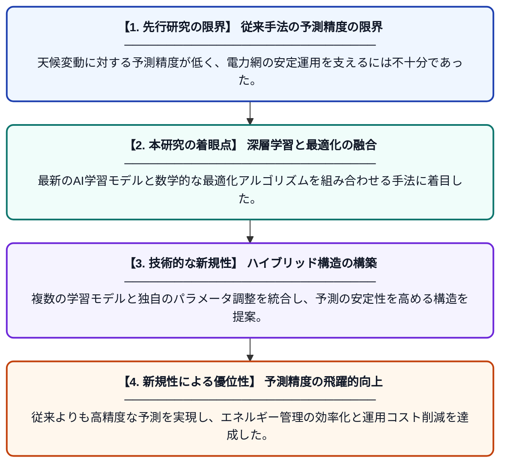

# 太陽光発電の予測および最適化技術に関する批判的レビュー

**Original Title**: *A critical review of photovoltaic power forecasting and optimization techniques*

> **💡 一言要約**: 太陽光発電の未来を支えるAI予測と最適化の集大成

| 項目 | 内容 |
|---|---|
| **著者** | M Gyam, İ Ceylan |
| **掲載誌** | Neural Computing and Applications 2026 |
| **アラートキーワード** | optimization |
| **原文リンク** | [https://link.springer.com/article/10.1007/s00521-026-12609-8](https://link.springer.com/article/10.1007/s00521-026-12609-8) |
| **PDF版要約** | [README.pdf](./README.pdf) |

---

## 📊 新規性の図解（先行研究との違いと本研究のブレークスルー）

## 📝 要約

世界的な太陽光発電の普及に伴い、電力網の安定性とエネルギー管理を支える高精度な発電量予測（PVPF）の重要性が増しています。本論文は、最新の予測モデルと最適化アルゴリズムを網羅的に調査し、次世代の技術的展望を提示しています。

## ❓ どんな問題に取り組んだか

太陽光発電は天候などの環境要因に大きく左右されるため、正確な予測が非常に困難です。従来の予測手法では、電力網の安定運用や効率的なエネルギー管理を実現するための精度と信頼性が不足しているという課題がありました。

## ✨ 何が新しい？何がすごい？（新規性）

本研究は、最新の深層学習モデルとメタヒューリスティック最適化アルゴリズムの統合に焦点を当てています。単なる手法の列挙ではなく、データの特性や計算効率といった実用的な観点から従来手法を再評価し、ハイブリッドモデルの有効性を体系的に示した点が画期的です。これにより、より不確実性の高い気象条件下でも機能する予測フレームワークの構築に貢献しました。

## 🎓 大学1年生向けの解説

太陽光パネルで電気を作る際、雲や雨で発電量が急に変わると、街全体の電気のバランスが崩れて停電などのトラブルが起きるかもしれません。そのため「いつ、どれだけ発電できるか」をAIを使って正しく予想することがとても大切です。この論文は、その予想の精度を限界まで高めるための最新のAI技術や計算の工夫をまとめて紹介しています。将来、私たちが再生可能エネルギーを安心して使うための大切な土台となる研究です。
