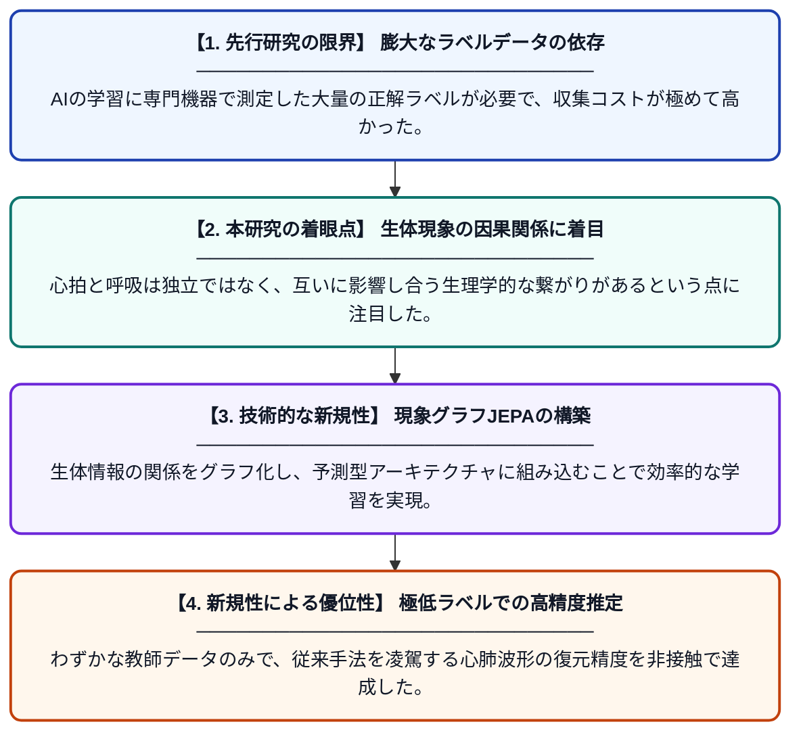

# Phenomenon-Graph JEPA: 非接触型心肺計測のためのラベル効率の高い表現学習

**Original Title**: *Phenomenon-Graph JEPA: Label-Efficient Representation Learning for Contactless Cardiorespiratory Sensing*

> **💡 一言要約**: 少ないデータで心拍・呼吸を精密に測るAI技術

| 項目 | 内容 |
|---|---|
| **著者** | C Álvarez Casado, N Nguyen, M Rakibur Rahman… |
| **掲載誌** | arXiv e-prints 2026 |
| **アラートキーワード** | representation learning |
| **原文リンク** | [https://ui.adsabs.harvard.edu/abs/2026arXiv260932928A/abstract](https://ui.adsabs.harvard.edu/abs/2026arXiv260932928A/abstract) |
| **PDF版要約** | [README.pdf](./README.pdf) |

---

## 📊 新規性の図解（先行研究との違いと本研究のブレークスルー）

## 📝 要約

ミリ波レーダーやRGB-Dカメラを用いた非接触な心肺モニタリングにおいて、ラベル付きデータの不足を解消する自己教師あり学習手法を提案しています。生体現象の因果関係をグラフ構造としてモデルに組み込むことで、少ないラベルデータでも高精度な心拍・呼吸波形の推定を可能にしました。

## ❓ どんな問題に取り組んだか

非接触センシングは便利ですが、学習に必要な正解ラベルを得るには専門機器での同時測定が必要で、大量のデータを集めるのが困難です。また、従来の自己教師あり学習では、心拍や呼吸といった生体信号特有の周期性や相互の関連性を十分に活用できていませんでした。

## ✨ 何が新しい？何がすごい？（新規性）

本研究の核心は、Joint-Embedding Predictive Architecture (JEPA) に「現象グラフ（Phenomenon-Graph）」を導入し、生理学的な因果関係を構造的にモデル化した点にあります。心拍と呼吸の相互作用をグラフとして定義することで、データ間の潜在的な繋がりを効率的に学習できるようになりました。この結果、従来の教師あり学習や一般的な自己教師あり学習を大きく上回るラベル効率と推定精度を達成しています。

## 🎓 大学1年生向けの解説

病院で体にセンサーを貼らなくても、カメラやレーダーを使って離れた場所から心臓や肺の動きを測る技術についての研究です。これまではAIを賢くするために、人間が「これが正しい心拍の波形です」と一つ一つ教える必要があり、その準備に膨大な手間がかかっていました。この研究では、心臓と肺がどう連動するかという「体の仕組み」をAIにヒントとして与えることで、少ないお手本からでも自ら正解を見つけ出せるように工夫しました。これにより、より簡単に精度の高い健康チェックができるようになります。
