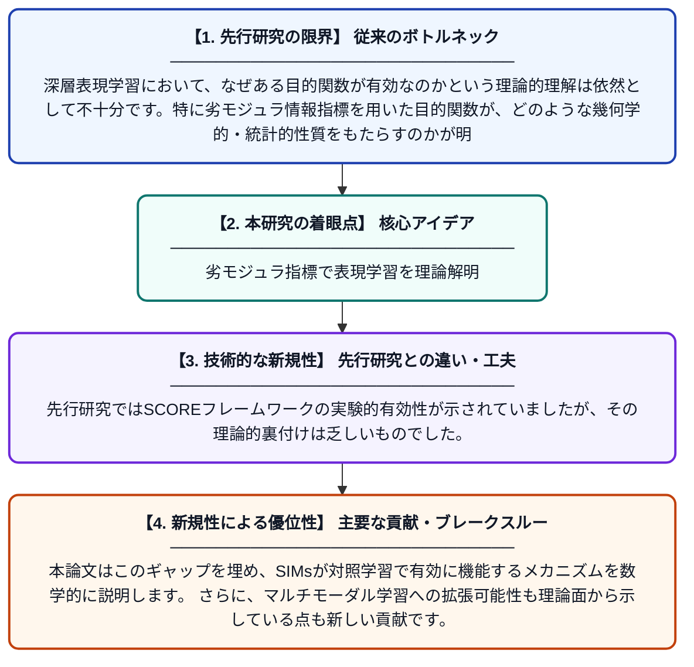

# 表現学習のための劣モジュラ情報指標に基づく目的関数の理解：分散と分離の視点から

**Original Title**: *Understanding Submodular Information Measure Based Objectives for Representation Learning: A Variance and Separation Perspective*

> **💡 一言要約**: 劣モジュラ指標で表現学習を理論解明

| 項目 | 内容 |
|---|---|
| **著者** | R Iyer, T Pham, A Majee |
| **掲載誌** | arXiv preprint arXiv:2607.27660 2026 |
| **アラートキーワード** | representation learning |
| **PDF** | [https://arxiv.org/pdf/2607.27660](https://arxiv.org/pdf/2607.27660) |
| **原文リンク** | [https://arxiv.org/pdf/2607.27660](https://arxiv.org/pdf/2607.27660) |
| **PDF版要約** | [README.pdf](./README.pdf) |

---

## 📊 新規性の図解（先行研究との違いと本研究のブレークスルー）

## 📝 要約

本論文は、劣モジュラ情報指標（SIMs）を表現学習やマルチモーダル学習の目的関数として活用するSCOREフレームワークを理論的に深く解析したものです。特に、SIMsに基づく目的関数が「クラス内分散の最小化」と「クラス間分離の最大化」という古典的な概念とどのように結びつくかを明らかにします。これにより、教師あり対照学習における有効性の理論的根拠が提供されます。

## ❓ どんな問題に取り組んだか

深層表現学習において、なぜある目的関数が有効なのかという理論的理解は依然として不十分です。特に劣モジュラ情報指標を用いた目的関数が、どのような幾何学的・統計的性質をもたらすのかが明確ではありませんでした。この理論的ギャップが、手法の改良や新手法設計の妨げとなっていました。

## ✨ 何が新しい？何がすごい？（新規性）

本研究は、SIMsに基づく目的関数を「分散（クラス内のばらつき）」と「分離（クラス間の距離）」という二つの古典的な観点から統一的に解釈する新しい理論的枠組みを提供します。先行研究ではSCOREフレームワークの実験的有効性が示されていましたが、その理論的裏付けは乏しいものでした。本論文はこのギャップを埋め、SIMsが対照学習で有効に機能するメカニズムを数学的に説明します。さらに、マルチモーダル学習への拡張可能性も理論面から示している点も新しい貢献です。

## 🎓 大学1年生向けの解説

機械学習では、コンピュータにデータの「良い特徴」を自動的に学ばせる「表現学習」という技術があります。この論文では、「劣モジュラ関数」という数学的な道具を使って、その学習をうまく導く方法を研究しています。難しく聞こえますが、要するに「同じグループのデータは近くに、違うグループのデータは遠くに配置されるように学習させる仕組み」を理論的に説明したものです。なぜその方法がうまくいくのかを数学的に証明することで、より信頼できるAI技術の開発につながります。
