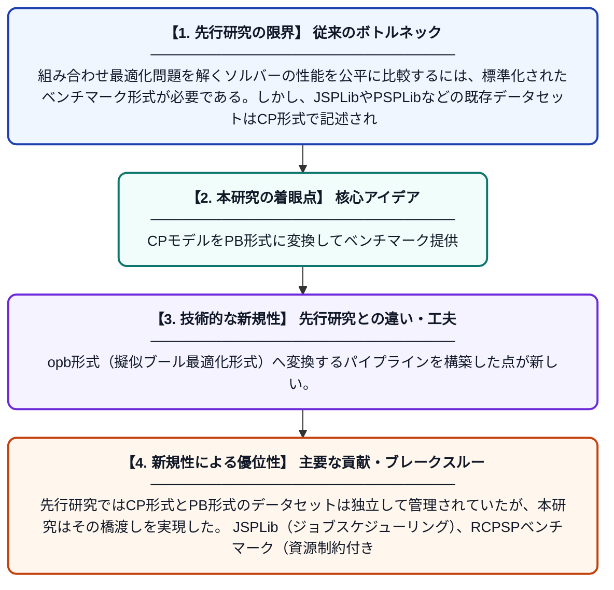

# CPMpyによるPB26競技会へのデータセット提出

**Original Title**: *CPMpy dataset submissions to PB26*

> **💡 一言要約**: CPモデルをPB形式に変換してベンチマーク提供

| 項目 | 内容 |
|---|---|
| **著者** | T Guns, T Sergeys, I Bleukx, H Bierlee |
| **アラートキーワード** | rcpsp |
| **PDF** | [https://www.cril.univ-artois.fr/PB26/files/PB26_dataset_submission.pdf](https://www.cril.univ-artois.fr/PB26/files/PB26_dataset_submission.pdf) |
| **Git リポジトリ** | [https://github.com/CPMpy/cpmpy](https://github.com/CPMpy/cpmpy) |
| **原文リンク** | [https://www.cril.univ-artois.fr/PB26/files/PB26_dataset_submission.pdf](https://www.cril.univ-artois.fr/PB26/files/PB26_dataset_submission.pdf) |
| **PDF版要約** | [README.pdf](./README.pdf) |

---

## 📊 新規性の図解（先行研究との違いと本研究のブレークスルー）

## 📝 要約

本論文は、PB26（Pseudo-Boolean競技会2026）に向けて、CPMpyフレームワークを用いてJSPLib、PSPLib RCPSP、MIPLibの各データセットをCP（制約プログラミング）モデルから.opbファイル形式に変換したことを報告する。特に、資源制約付きプロジェクトスケジューリング問題（RCPSP）を含む複数の組み合わせ最適化問題を擬似ブール最適化形式に翻訳している。これにより、異なるソルバーが同一ベンチマーク上で比較できる環境を整備することに貢献している。

## ❓ どんな問題に取り組んだか

組み合わせ最適化問題を解くソルバーの性能を公平に比較するには、標準化されたベンチマーク形式が必要である。しかし、JSPLibやPSPLibなどの既存データセットはCP形式で記述されており、擬似ブール最適化（PB）競技会で直接利用できない形式であった。

## ✨ 何が新しい？何がすごい？（新規性）

CPMpyというPythonベースの制約プログラミングフレームワークを活用し、既存の著名なCPデータセットを自動的に.opb形式（擬似ブール最適化形式）へ変換するパイプラインを構築した点が新しい。先行研究ではCP形式とPB形式のデータセットは独立して管理されていたが、本研究はその橋渡しを実現した。JSPLib（ジョブスケジューリング）、RCPSPベンチマーク（資源制約付きスケジューリング）、MIPLibという多様な問題群を一括変換した点も貢献の一つである。

## 🎓 大学1年生向けの解説

「スケジュール最適化」とは、限られた資源（人や機械）を使って仕事を最も効率よく終わらせる方法を計算する問題です。この論文では、そのような問題をコンピュータが解きやすい別の形式（擬似ブール最適化）に自動で変換するツールを作りました。さまざまな有名な問題集（データセット）を新しい形式に変換することで、世界中の研究者が同じ問題でプログラムの性能を比べやすくなります。いわば、異なる言語で書かれたテスト問題を共通語に翻訳したようなイメージです。
