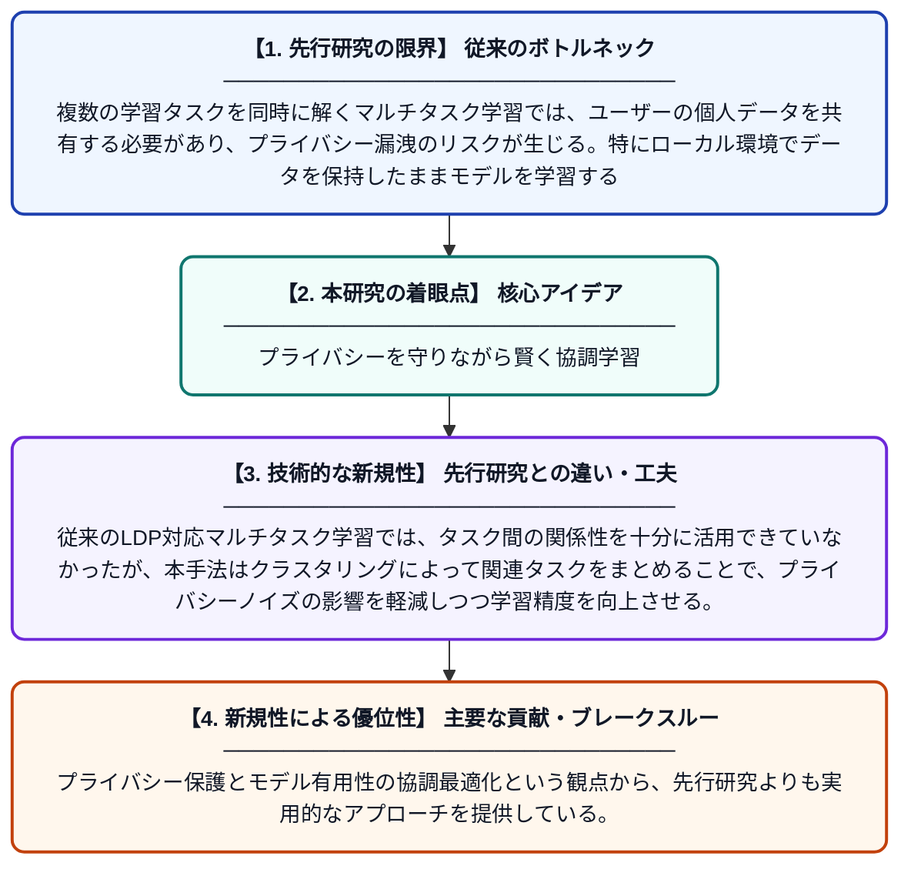

# ローカル差分プライバシーを満たす2段階クラスタリングベースのマルチタスク学習アルゴリズム

**Original Title**: *Two-Stage Clustering-Based Multi-Task Learning Algorithm Under Local Differential Privacy.*

> **💡 一言要約**: プライバシーを守りながら賢く協調学習

| 項目 | 内容 |
|---|---|
| **著者** | X FANG, J CHENG, P ZHANG, X FANG, J CHEN |
| **掲載誌** | Journal of Computer Science 2026 |
| **アラートキーワード** | differential privacy |
| **原文リンク** | [https://openurl.ebsco.com/contentitem/gcd:194663076?sid=ebsco:plink:crawler-gcd&id=ebsco:gcd:194663076&crl=c&jrnl=10028331](https://openurl.ebsco.com/contentitem/gcd:194663076?sid=ebsco:plink:crawler-gcd&id=ebsco:gcd:194663076&crl=c&jrnl=10028331) |
| **PDF版要約** | [README.pdf](./README.pdf) |

---

## 📊 新規性の図解（先行研究との違いと本研究のブレークスルー）

## 📝 要約

本論文では、ローカル差分プライバシー（LDP）を満たすK-Meansクラスタリングベースの2段階マルチタスク学習アルゴリズム（KTMTL）を提案する。第1段階では改良されたK-Meansクラスタリングによってタスクをグループ化し、第2段階では各クラスタ内でプライバシーを保護しながら協調学習を行う。これによりプライバシー保護とモデルの有用性を同時に最適化することを目指している。

## ❓ どんな問題に取り組んだか

複数の学習タスクを同時に解くマルチタスク学習では、ユーザーの個人データを共有する必要があり、プライバシー漏洩のリスクが生じる。特にローカル環境でデータを保持したままモデルを学習する場合、プライバシー保護と高い学習精度の両立が困難であった。また、タスク間の関連性を適切に考慮しないと学習効率が低下するという課題もあった。

## ✨ 何が新しい？何がすごい？（新規性）

本研究の主な新規性は、K-Meansクラスタリングを改良してタスク間の類似性を自動的にグループ化する2段階構造をLDPと組み合わせた点にある。従来のLDP対応マルチタスク学習では、タスク間の関係性を十分に活用できていなかったが、本手法はクラスタリングによって関連タスクをまとめることで、プライバシーノイズの影響を軽減しつつ学習精度を向上させる。プライバシー保護とモデル有用性の協調最適化という観点から、先行研究よりも実用的なアプローチを提供している。

## 🎓 大学1年生向けの解説

「マルチタスク学習」とは、複数の問題を同時に解くことで互いの学習を助け合う技術です。しかし、学習にはユーザーの個人データが必要なため、プライバシーが心配されます。この研究では「ローカル差分プライバシー」という技術を使い、データをデバイス外に出さずに安全に学習できる仕組みを作りました。さらに、似たような問題どうしをK-Meansクラスタリングでグループ分けすることで、プライバシーを守りながらも高い精度を実現しています。プライバシーと性能の両方を同時に改善するアルゴリズムを提案した研究です。
