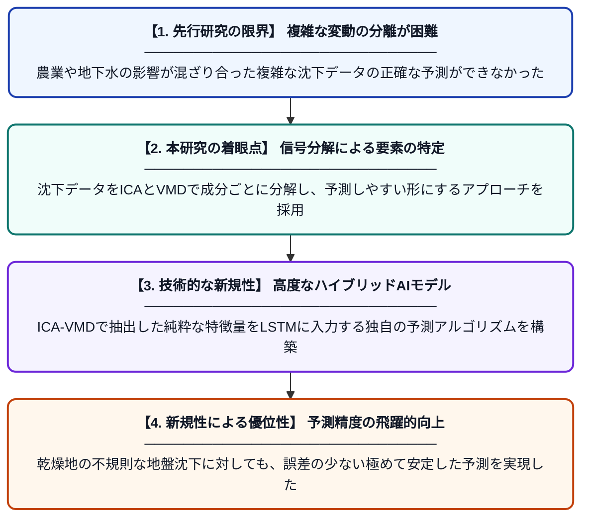

# MCTSB-InSARとICA-VMD-LSTMを用いたタリム盆地北部の地盤沈下監視と予測

**Original Title**: *Monitoring and Prediction of Ground Subsidence in the Northern Tarim Basin Based on MCTSB-InSAR and ICA-VMD-LSTM*

> **💡 一言要約**: 衛星とAIで砂漠の農地の地盤沈下を精密に予測

| 項目 | 内容 |
|---|---|
| **著者** | J Qi, Y Zhang, Y Fan, D Liu, Z Pang |
| **掲載誌** | Advances in Space Research 2026 |
| **アラートキーワード** | ICA |
| **原文リンク** | [https://www.sciencedirect.com/science/article/pii/S0273117726015425](https://www.sciencedirect.com/science/article/pii/S0273117726015425) |
| **PDF版要約** | [README.pdf](./README.pdf) |

---

## 📊 新規性の図解（先行研究との違いと本研究のブレークスルー）

## 📝 要約

中国タリム盆地北部のオアシス農業地帯において、最新の衛星リモートセンシング技術とAIモデルを組み合わせ、地盤沈下の実態解明と高精度な予測を行いました。地下水抽出や灌漑、土地利用の変化が沈下に与える影響を分析し、複雑な変動パターンを特定する新たな手法を提案しています。

## ❓ どんな問題に取り組んだか

乾燥地域の農業地帯では、地下水の過剰利用により深刻な地盤沈下が発生していますが、その変動は農業活動や気象条件が複雑に絡み合っています。従来の観測・予測手法では、これらの複雑な非線形データを精度よく分離して将来の沈下量を予測することが困難でした。

## ✨ 何が新しい？何がすごい？（新規性）

本研究は、MCTSB-InSARによる高精度観測に、独立成分分析（ICA）、変分モード分解（VMD）、そして長短期記憶（LSTM）を統合したハイブリッドモデルを開発しました。これにより、沈下データからノイズや季節変動を効果的に分離し、予測精度を従来手法より大幅に向上させた点が最大の特徴です。また、広域の地盤沈下と土地利用の変化を空間的に関連付けた点も画期的です。

## 🎓 大学1年生向けの解説

砂漠にある農地では、作物を育てるために地下水をたくさん使いますが、それによって地面が沈んでしまう問題があります。この研究では、宇宙にある人工衛星を使って地面のわずかな動きをキャッチし、さらにAIを使って「いつ、どれくらい沈むのか」を正確に予測しました。複雑なデータの変化をパズルのように分解して分析することで、これまでの方法よりもずっと正確に未来の地面の動きを当てることができるようになりました。
