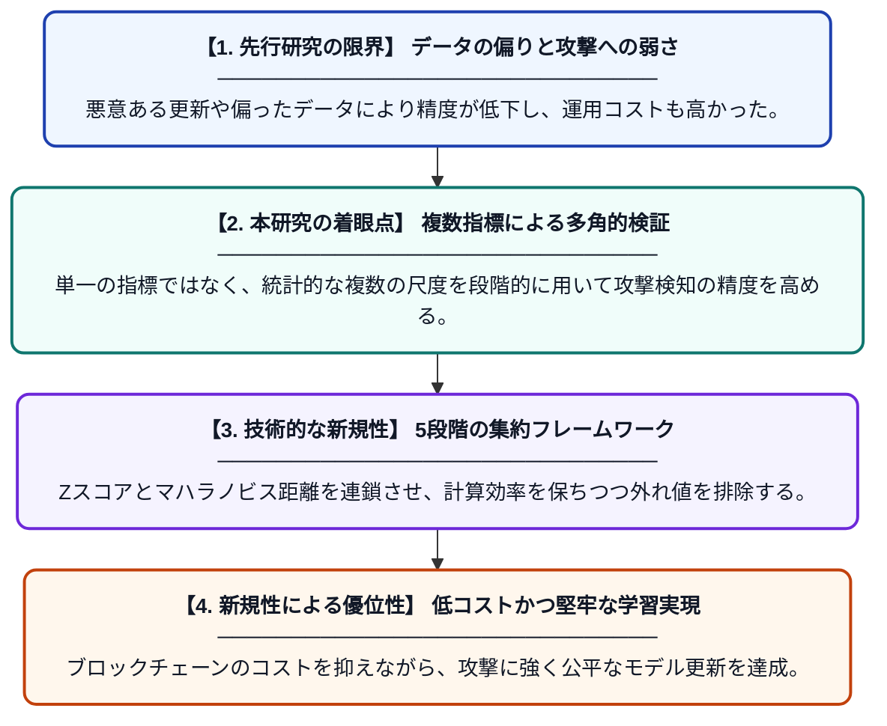

# コスト効率と公平性を両立するブロックチェーン連合学習のための適応的多指標集約

**Original Title**: *Adaptive multi-metric aggregation for cost-efficient and fair blockchain-federated learning*

> **💡 一言要約**: コストを抑え攻撃を防ぐ、公平な連合学習の進化形

| 項目 | 内容 |
|---|---|
| **著者** | R Sharma, S Sahay, Y Sahu, G Vishwakarma… |
| **掲載誌** | Applied Intelligence 2026 |
| **アラートキーワード** | Federated Learning |
| **原文リンク** | [https://link.springer.com/article/10.1007/s10489-026-07561-y](https://link.springer.com/article/10.1007/s10489-026-07561-y) |
| **PDF版要約** | [README.pdf](./README.pdf) |

---

## 📊 新規性の図解（先行研究との違いと本研究のブレークスルー）

## 📝 要約

非均質なデータ分布や敵対的な攻撃、さらにブロックチェーンの運用コストという課題を同時に解決する「Hybrid Fair」という5段階の集約フレームワークを提案しています。Zスコアとマハラノビス距離を組み合わせた外れ値検出により、悪意のある更新を排除しながら効率的で公平なモデル学習を実現しました。

## ❓ どんな問題に取り組んだか

連合学習では、参加者が持つデータの偏りや悪意のある攻撃者による偽の更新が精度を低下させる大きな課題となっています。また、信頼性確保のためにブロックチェーンを導入すると、計算量や通信量に伴うコストが膨大になるという問題がありました。

## ✨ 何が新しい？何がすごい？（新規性）

本研究の最大の貢献は、Zスコアとマハラノビス距離を連鎖的に適用する「Hybrid Fair」と呼ばれる5段階の適応型集約プロセスを構築した点にあります。この多段階の検証により、計算負荷を最小限に抑えつつ、従来の単一指標では見抜けなかった巧妙な敵対的更新を高い精度で検出・排除することが可能になりました。先行研究と比較して、ブロックチェーンのガス代等のコストを削減しながら、データが偏った環境下でも高い公平性と堅牢性を両立させています。

## 🎓 大学1年生向けの解説

たくさんのスマホやPCで協力してAIを育てる「連合学習」では、わざと間違った情報を送って邪魔をする悪い参加者が紛れ込むことがあります。この研究は、送られてきたデータが正しいかを複数の数学的なテスト（Zスコアやマハラノビス距離）を使って厳しくチェックする仕組みを作りました。また、記録のために使うブロックチェーンの手数料を安くする工夫もされています。これにより、安くて安全に、みんなの役に立つAIを作れるようになります。
