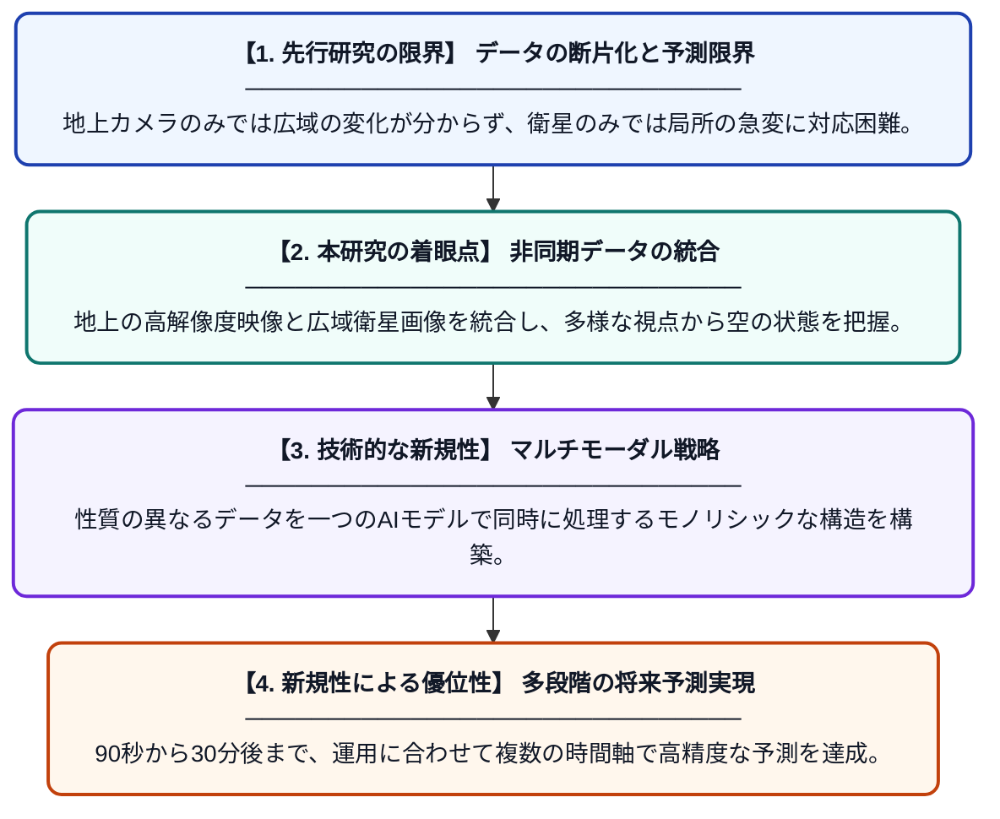

# ベラ・C・ルービン天文台のためのマルチモーダル透過率予測

**Original Title**: *Multi-modal transmission forecasting for the Vera C. Rubin Observatory*

> **💡 一言要約**: AIで星空の透明度を30分先まで予測

| 項目 | 内容 |
|---|---|
| **著者** | P Xiangyuan Ma, JS Bloom |
| **掲載誌** | arXiv e-prints 2026 |
| **アラートキーワード** | Multi Camera Tracking |
| **原文リンク** | [https://ui.adsabs.harvard.edu/abs/2026arXiv261022725X/abstract](https://ui.adsabs.harvard.edu/abs/2026arXiv261022725X/abstract) |
| **PDF版要約** | [README.pdf](./README.pdf) |

---

## 📊 新規性の図解（先行研究との違いと本研究のブレークスルー）

## 📝 要約

地上カメラと気象衛星の異なるデータを統合したAIモデルにより、天体観測に影響する空の透過率を予測する手法を開発しました。90秒後から30分後までの複数の時間区分において、高精度な予測が可能であることを示しています。

## ❓ どんな問題に取り組んだか

天体観測において、雲や大気の状態による光の透過率の変化は観測品質を左右する大きな要因です。しかし、急速に変化する局所的な気象と広域的な雲の動きを同時に考慮し、複数の時間スケールで正確に予測することは極めて困難でした。

## ✨ 何が新しい？何がすごい？（新規性）

地上のDREAMカメラと宇宙の気象衛星という、更新頻度や情報の質が異なる「非同期データ」を一つのモデルで扱う『モノリシック・マルチモーダル戦略』を導入した点が最大の特徴です。これにより、直近90秒の急激な変化から30分先の広域的な変化まで、単一のシステムで一貫して予測できる能力を獲得しました。従来の手法では困難だった、異なる観測ソースの相乗効果を最大限に引き出すことに成功しています。

## 🎓 大学1年生向けの解説

望遠鏡で宇宙を観察するとき、雲が出たり空がかすんだりすると、きれいな写真が撮れません。この研究は、地面にあるカメラと宇宙にある気象衛星の映像をAIに学習させ、「あと何分後に空がどれくらい透き通るか」を予測する仕組みを作りました。これは「天体観測専用の超精密な天気予報」のようなものです。これによって、貴重な望遠鏡の時間を無駄にせず、最も良いタイミングで観測を行えるようになります。
