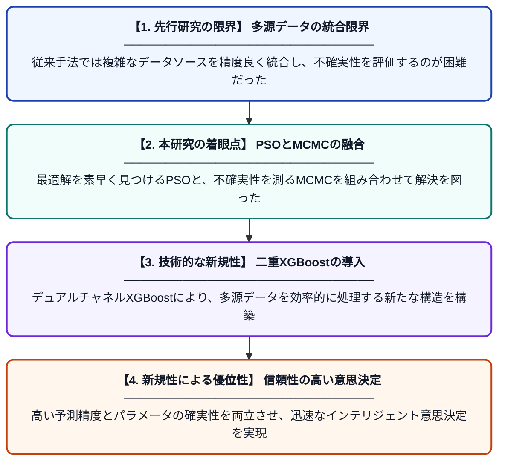

# 粒子群最適化とデュアルチャネルXGBoostに基づく多源意思決定インテリジェントアルゴリズムの枠組みとシステム

**Original Title**: *A multisource decision intelligent algorithm framework and system based on particle swarm optimization and dual-channel XGBoost*

> **💡 一言要約**: PSOとXGBoostで導く、高精度な多源意思決定

| 項目 | 内容 |
|---|---|
| **著者** | Y Wang, T Wang, X Zhang, R Xie |
| **掲載誌** | … Conference on Algorithms, Image Processing, and … 2026 |
| **アラートキーワード** | MCMC |
| **原文リンク** | [https://www.spiedigitallibrary.org/conference-proceedings-of-spie/14504/1450405/A-multisource-decision-intelligent-algorithm-framework-and-system-based-on/10.1117/12.3125571.short](https://www.spiedigitallibrary.org/conference-proceedings-of-spie/14504/1450405/A-multisource-decision-intelligent-algorithm-framework-and-system-based-on/10.1117/12.3125571.short) |
| **PDF版要約** | [README.pdf](./README.pdf) |

---

## 📊 新規性の図解（先行研究との違いと本研究のブレークスルー）

## 📝 要約

粒子群最適化（PSO）とデュアルチャネルXGBoostを組み合わせた、新しい多源意思決定アルゴリズムのフレームワークを提案した研究です。PSOによる最適化とMCMCサンプリングを統合することで、パラメータの不確実性を評価しながら高精度な予測と意思決定を実現しています。

## ❓ どんな問題に取り組んだか

複雑な多源データを扱う際、従来のアルゴリズムでは計算効率と予測精度の両立が難しく、不確実性の評価も不十分でした。特に、多様なデータソースを統合して最適な意思決定を迅速に下すための体系的な枠組みが欠如していました。

## ✨ 何が新しい？何がすごい？（新規性）

粒子群最適化（PSO）を用いた逆解析と、パラメータの不確実性を特徴付けるMCMCサンプリングをハイブリッド化した点が最大の特徴です。さらに、デュアルチャネルXGBoostを採用することで多源データの並列的な特徴抽出を可能にし、予測の堅牢性を高めています。この統合アプローチにより、従来の単一アルゴリズムでは到達できなかった精度と信頼性の高い意思決定を支援するシステムを実現しました。

## 🎓 大学1年生向けの解説

この研究は、たくさんの情報源からベストな答えを見つけ出すための「究極の賢い計算方法」を開発したものです。鳥の群れがエサを探す様子を真似た「PSO」という方法と、AIの中でも非常に強力な「XGBoost」という技術を組み合わせています。さらに、ただ答えを出すだけでなく、その答えがどのくらい確かなのかをチェックする機能も備わっています。これにより、複雑な問題に対しても、より正確で失敗の少ない判断ができるようになります。
