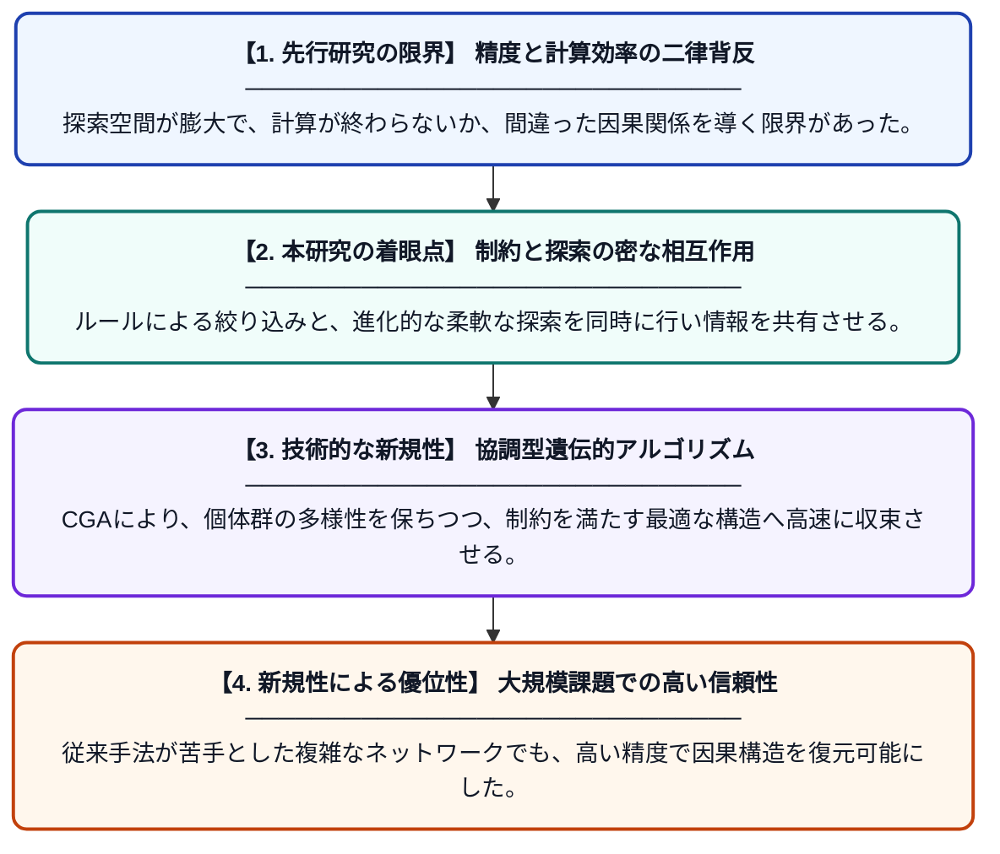

# ベイジアンネットワーク構造学習のための制約探索協調型遺伝的アルゴリズム

**Original Title**: *Constraint-Search Collaborative Genetic Algorithm for Bayesian Network Structure Learning*

> **💡 一言要約**: 制約と進化の協調で真の因果関係を効率的に特定

| 項目 | 内容 |
|---|---|
| **著者** | Z He, H Lu, S Zhu, Y Shi, W Fang, K Deb |
| **掲載誌** | Artificial Intelligence 2026 |
| **アラートキーワード** | bayesian network |
| **原文リンク** | [https://www.sciencedirect.com/science/article/pii/S0004370226001815](https://www.sciencedirect.com/science/article/pii/S0004370226001815) |
| **PDF版要約** | [README.pdf](./README.pdf) |

---

## 📊 新規性の図解（先行研究との違いと本研究のブレークスルー）

## 📝 要約

ベイジアンネットワークの構造学習において、制約ベースとスコアベースの長所を融合した「協調型遺伝的アルゴリズム（CGA）」を提案しています。制約による探索空間の絞り込みと、遺伝的アルゴリズムによる大域的な探索を同期させることで、複雑な因果構造を効率的かつ高精度に推定することに成功しました。

## ❓ どんな問題に取り組んだか

観測データから最適な因果グラフを導き出す「構造学習」は、候補となるグラフの組み合わせが爆発的に増えるため、計算が極めて困難です。従来の制約ベース手法は誤差に弱く、スコアベース手法は広大な探索空間で局所解に陥りやすいという課題がありました。

## ✨ 何が新しい？何がすごい？（新規性）

本研究の最大の特徴は、制約探索と進化的探索を独立して行うのではなく、互いにフィードバックを与える「協調型」のフレームワークを構築した点にあります。遺伝的アルゴリズムが有望な構造を探索する一方で、制約ベースの知見を用いて探索の方向性を動的に修正し、無駄な計算を大幅に削減しています。進化計算の世界的権威であるK. Deb氏らが参加しており、多目的最適化の視点を取り入れた堅牢なアルゴリズム構成が実現されています。

## 🎓 大学1年生向けの解説

物事の「原因と結果」の関係を網の目のように繋いだ図をベイジアンネットワークと呼びます。この図をデータから自動で作るのは非常に難しいのですが、この研究では「生物の進化」の仕組みをヒントにした計算方法を使いました。さらに、適当に探すのではなく「あり得ないつながり」をルールで弾きながら探す工夫をしています。これにより、複雑なデータからでも正解の図を素早く見つけられるようになりました。
