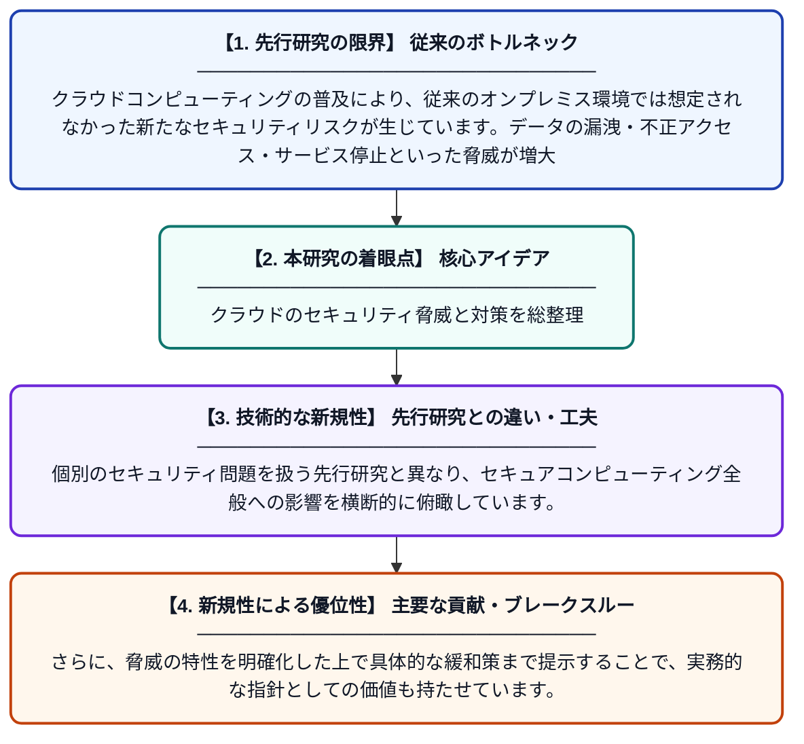

# クラウドコンピューティングがセキュアな計算環境に与える影響：損失・脅威・脆弱性とその緩和策

**Original Title**: *Implications of Cloud Computing on Secure Computing Capabilities and Environments: Losses, Threats, Vulnerabilities, and Mitigation*

> **💡 一言要約**: クラウドのセキュリティ脅威と対策を総整理

| 項目 | 内容 |
|---|---|
| **著者** | M Adamou |
| **アラートキーワード** | Secure Computing |
| **PDF** | [https://www.researchgate.net/profile/Musa-Adamou/publication/410721617_Implications_of_Cloud_Computing_on_Secure_Computing_Capabilities_and_Environments_Losses_Threats_Vulnerabilities_and_Mitigation/links/6a61879cf475b23f400e4cb0/Implications-of-Cloud-Computing-on-Secure-Computing-Capabilities-and-Environments-Losses-Threats-Vulnerabilities-and-Mitigation.pdf](https://www.researchgate.net/profile/Musa-Adamou/publication/410721617_Implications_of_Cloud_Computing_on_Secure_Computing_Capabilities_and_Environments_Losses_Threats_Vulnerabilities_and_Mitigation/links/6a61879cf475b23f400e4cb0/Implications-of-Cloud-Computing-on-Secure-Computing-Capabilities-and-Environments-Losses-Threats-Vulnerabilities-and-Mitigation.pdf) |
| **原文リンク** | [https://www.researchgate.net/profile/Musa-Adamou/publication/410721617_Implications_of_Cloud_Computing_on_Secure_Computing_Capabilities_and_Environments_Losses_Threats_Vulnerabilities_and_Mitigation/links/6a61879cf475b23f400e4cb0/Implications-of-Cloud-Computing-on-Secure-Computing-Capabilities-and-Environments-Losses-Threats-Vulnerabilities-and-Mitigation.pdf](https://www.researchgate.net/profile/Musa-Adamou/publication/410721617_Implications_of_Cloud_Computing_on_Secure_Computing_Capabilities_and_Environments_Losses_Threats_Vulnerabilities_and_Mitigation/links/6a61879cf475b23f400e4cb0/Implications-of-Cloud-Computing-on-Secure-Computing-Capabilities-and-Environments-Losses-Threats-Vulnerabilities-and-Mitigation.pdf) |
| **PDF版要約** | [README.pdf](./README.pdf) |

---

## 📊 新規性の図解（先行研究との違いと本研究のブレークスルー）

## 📝 要約

本論文は、クラウドコンピューティングが従来のセキュアな計算能力・環境に与える影響を包括的にレビューしたものです。クラウドセキュリティアライアンス（CSA）が特定したクラウドへの主要脅威を整理し、脆弱性や損失のリスクを体系的に分析しています。さらに、それらのリスクを軽減するための対策についても論じています。

## ❓ どんな問題に取り組んだか

クラウドコンピューティングの普及により、従来のオンプレミス環境では想定されなかった新たなセキュリティリスクが生じています。データの漏洩・不正アクセス・サービス停止といった脅威が増大しており、組織がクラウドへ移行する際にどのようなセキュリティ上の損失や脆弱性が発生するかを体系的に把握することが急務となっています。

## ✨ 何が新しい？何がすごい？（新規性）

本研究は、クラウドセキュリティアライアンス（CSA）の知見を基盤としながら、クラウド環境特有の脅威・脆弱性・損失を一つの枠組みで整理・分類した点に新規性があります。個別のセキュリティ問題を扱う先行研究と異なり、セキュアコンピューティング全般への影響を横断的に俯瞰しています。さらに、脅威の特性を明確化した上で具体的な緩和策まで提示することで、実務的な指針としての価値も持たせています。

## 🎓 大学1年生向けの解説

クラウドコンピューティングとは、インターネットを通じてデータやソフトウェアを利用する仕組みで、私たちが日常的に使うサービスの多くがこれで動いています。しかし便利な反面、悪意ある第三者によるデータ盗用やシステムへの不正侵入といった危険も増えています。この論文では、クラウドを使うことでどんなセキュリティ上の問題が起きうるかをわかりやすく整理し、それを防ぐための方法を提案しています。いわば「クラウドの危険と安全対策をまとめた教科書」のような研究です。
