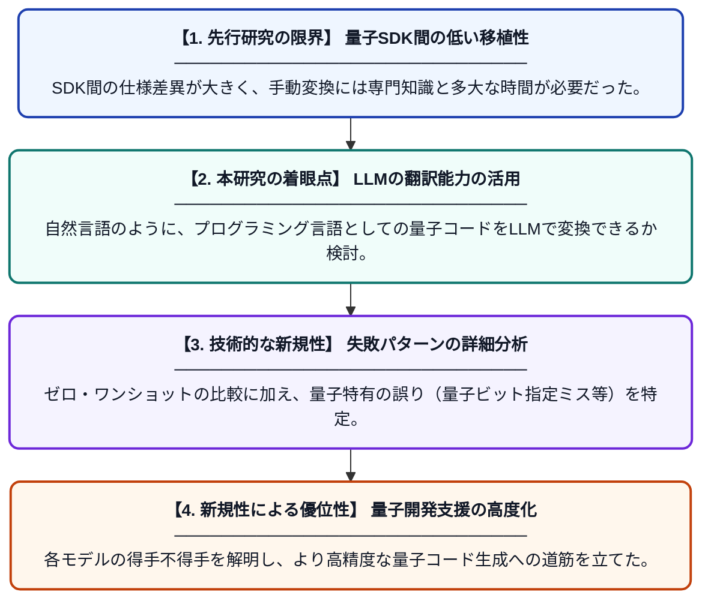

# 量子コード変換のための大規模言語モデル：探索的研究

**Original Title**: *Large Language Models for Quantum Code Translation: An Exploratory Study*

> **💡 一言要約**: LLMによる量子コード変換の性能と課題を解明

| 項目 | 内容 |
|---|---|
| **著者** | X Li, Y Li, J Zhao |
| **掲載誌** | arXiv preprint arXiv:2610.34841 2026 |
| **アラートキーワード** | one shot |
| **PDF** | [https://arxiv.org/pdf/2610.34841](https://arxiv.org/pdf/2610.34841) |
| **原文リンク** | [https://arxiv.org/pdf/2610.34841](https://arxiv.org/pdf/2610.34841) |
| **PDF版要約** | [README.pdf](./README.pdf) |

---

## 📊 新規性の図解（先行研究との違いと本研究のブレークスルー）

## 📝 要約

大規模言語モデル（LLM）を用いて、異なる量子ソフトウェア開発キット（SDK）間でコードを変換する際の性能を調査した研究です。ゼロショットおよびワンショットプロンプトによる精度の違いや、モデル特有の失敗パターンを詳細に分析しています。

## ❓ どんな問題に取り組んだか

量子コンピュータには複数のSDKが存在しますが、それらの間でコードを変換・移植する作業は複雑で手間がかかります。また、LLMが量子回路特有の論理構造や制約をどの程度正確に理解し、変換できるかについては十分に検証されていませんでした。

## ✨ 何が新しい？何がすごい？（新規性）

最新のLLM（ProやGLMなど）を対象に、量子コード変換におけるゼロショットとワンショットプロンプトの影響を系統的に比較した点が画期的です。単なる成功率の測定だけでなく、失敗のプロファイルを分類することで、量子コード特有の構文エラーや論理的な誤りの傾向を明らかにしました。これにより、量子プログラミング支援におけるLLMの具体的な限界と改善の方向性を提示しています。

## 🎓 大学1年生向けの解説

量子コンピュータを動かすプログラムには、いくつかの異なる「書き方（SDK）」があります。この研究は、AIを使ってある書き方のプログラムを別の書き方へ自動で翻訳させる実験をしました。AIに1つだけお手本を見せることで、翻訳の正解率がどう変わるかや、AIがどんな間違いをしやすいかを詳しく調べています。これによって、将来AIが量子コンピュータのプログラムを自動で作るためのヒントが見つかりました。
