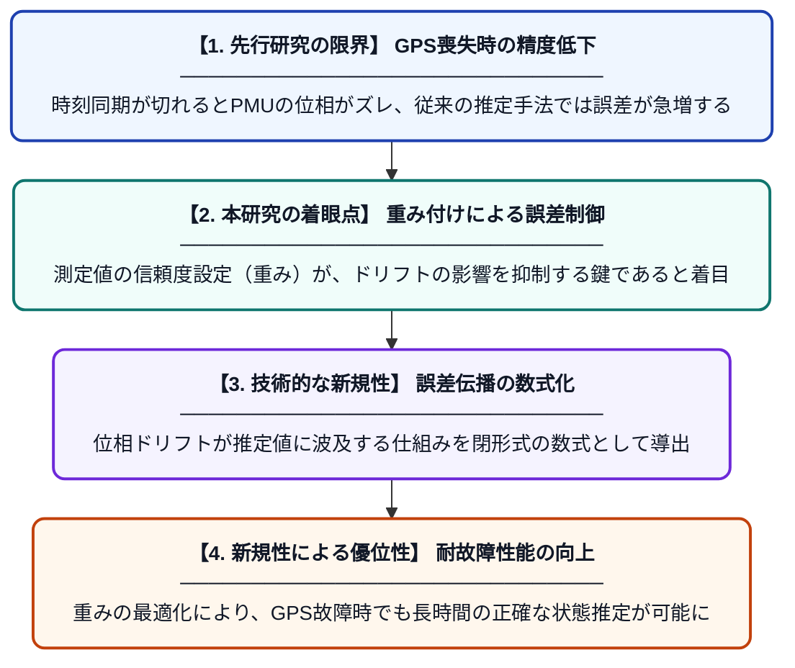

# PMUを用いた発電機動的状態推定における、測定値の重み付けがGPSホールドオーバー耐性を決定する

**Original Title**: *Measurement Weighting Sets the GPS-Holdover Tolerance of PMU-Based Generator Dynamic State Estimation*

> **💡 一言要約**: 重み設定でGPS故障時の推定精度を守る

| 項目 | 内容 |
|---|---|
| **著者** | LGP Marcondes, RC Pires |
| **掲載誌** | 2026 |
| **アラートキーワード** | kalman filter |
| **原文リンク** | [https://www.preprints.org/manuscript/202611.1646](https://www.preprints.org/manuscript/202611.1646) |
| **PDF版要約** | [README.pdf](./README.pdf) |

---

## 📊 新規性の図解（先行研究との違いと本研究のブレークスルー）

## 📝 要約

本論文は、PMU（フェーザ測定装置）を用いた発電機の動的状態推定において、GPS信号が途絶した際の位相ドリフトが推定精度に与える影響を研究しています。IEEE 39バス系統を用いたシミュレーションを通じて、拡張カルマンフィルタにおける測定値の重み付けが、GPS故障に対するシステムの耐性を左右することを数式で明らかにしました。

## ❓ どんな問題に取り組んだか

PMUはGPSによる精密な時刻同期に依存していますが、信号が遮断されると内部時計がずれる「位相ドリフト」が発生し、推定精度が著しく低下します。これまで、このドリフトが状態推定にどの程度波及するか、またシステムのパラメータ設定が耐性にどう影響するかという定量的分析が不十分でした。

## ✨ 何が新しい？何がすごい？（新規性）

拡張カルマンフィルタ（EKF）において、PMUの位相ドリフトが推定誤差として伝播する割合を示す「閉形式（Closed-form）」の数式を初めて導出した点が最大の貢献です。これにより、測定ノイズの共分散行列（重み）を調整することで、GPSが機能しない期間でも推定精度を維持できる時間を理論的に制御可能にしました。先行研究とは異なり、確率的な負荷変動や現場レベルのノイズを考慮した現実的な環境下でその有効性を証明しています。

## 🎓 大学1年生向けの解説

発電所が正しく動いているか調べるには、GPSで時間を合わせた超精密なセンサー（PMU）を使います。しかし、GPSの電波が途切れるとセンサーの時計が少しずつズレてしまい、正しいデータが取れなくなるという弱点がありました。この研究は、データの「信じ方（重み付け）」を工夫することで、GPSが切れてもセンサーのズレを無視して正しく監視し続けられる時間を延ばす方法を見つけました。数学を使って、停電などのトラブルに強い電力網を作るための重要な一歩です。
