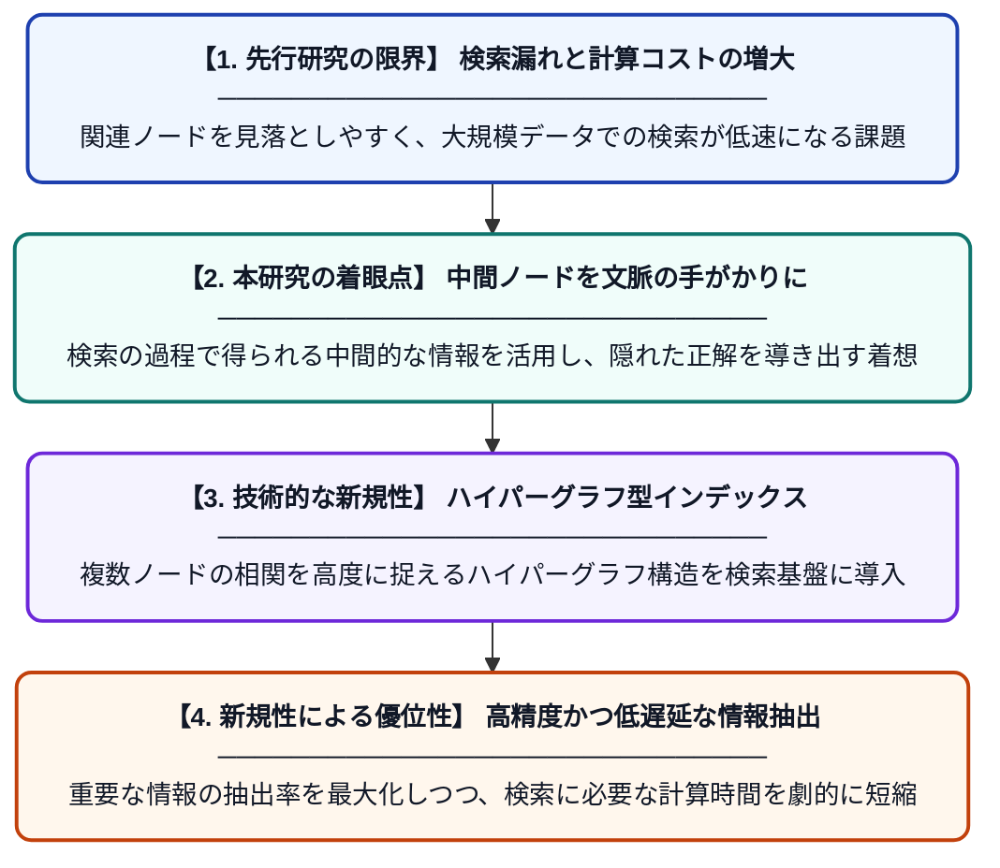

# GraFine: コーパスグラフ上の効率的なGraph RAGのための検索時リファインメント

**Original Title**: *GraFine: Retrieval-Time Refinement for Efficient Graph RAG over Corpus Graphs*

> **💡 一言要約**: ハイパーグラフで検索を研ぎ澄ます次世代Graph RAG

| 項目 | 内容 |
|---|---|
| **著者** | S An, C Hyun, MS Kim |
| **掲載誌** | Proceedings of the 35th ACM International Conference … 2026 |
| **アラートキーワード** | graph rag |
| **原文リンク** | [https://dl.acm.org/doi/abs/10.1145/3799682.3840565](https://dl.acm.org/doi/abs/10.1145/3799682.3840565) |
| **PDF版要約** | [README.pdf](./README.pdf) |

---

## 📊 新規性の図解（先行研究との違いと本研究のブレークスルー）

## 📝 要約

大規模な文書群（コーパス）を対象としたGraph RAGにおいて、検索時に情報を動的に洗練させる新手法「GraFine」を提案しています。ハイパーグラフベースのインデックスを活用することで、中間ノードに含まれる文脈的な手がかりを効率的に抽出し、検索精度の向上と計算コストの削減を両立させています。

## ❓ どんな問題に取り組んだか

従来のGraph RAGでは、検索時に重要な関連情報（オラクル）を見落とすことが多く、また大規模なグラフ構造を扱う際の計算効率も課題でした。特に、ノード間に存在する潜在的な文脈情報を検索プロセスに十分に反映できていないという問題がありました。

## ✨ 何が新しい？何がすごい？（新規性）

本研究の核心は、検索プロセスそのものを洗練させる「リファインメント」と「ハイパーグラフ」の導入にあります。複数のノード間の複雑な関係を一度に記述できるハイパーグラフ構造をインデックスに採用することで、従来のグラフでは捉えきれなかった高次の関連性をモデル化しました。これにより、検索時に動的にコンテキストを最適化し、不要な探索を省きながら正解に辿り着く効率性が飛躍的に向上しています。

## 🎓 大学1年生向けの解説

AIが膨大な資料から答えを探すとき、これまでは「関連しそうなキーワード」を一つずつ辿っていました。しかし、この研究では「情報のつながり（グラフ）」をより高度な網目状（ハイパーグラフ）にし、探し物の途中で「こっちの方向がもっと正しそうだ」と探し方を賢く修正する仕組みを作りました。これにより、まるでベテランの図書館員が関連する本を次々と見つけるように、正確で素早い検索が可能になります。
