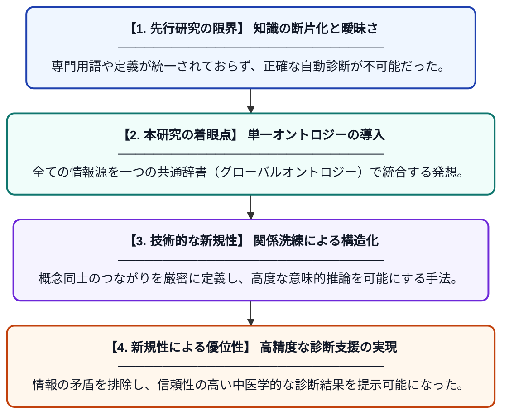

# 関係洗練に基づく中医学オントロジー指向診断システム

**Original Title**: *Research Article Ontology-Oriented Diagnostic System for Traditional Chinese Medicine Based on Relation Refinement*

> **💡 一言要約**: オントロジーで中医学診断を高度化するAIシステム

| 項目 | 内容 |
|---|---|
| **著者** | P Gu, H Chen, T Yu |
| **アラートキーワード** | Ontology |
| **PDF** | [https://www.academia.edu/download/135360215/317803.pdf](https://www.academia.edu/download/135360215/317803.pdf) |
| **原文リンク** | [https://www.academia.edu/download/135360215/317803.pdf](https://www.academia.edu/download/135360215/317803.pdf) |
| **PDF版要約** | [README.pdf](./README.pdf) |

---

## 📊 新規性の図解（先行研究との違いと本研究のブレークスルー）

## 📝 要約

中医学（TCM）の診断を支援するため、ドメインオントロジーを活用した新しい診断システムを提案しています。単一のグローバルオントロジーを構築して共有語彙を提供し、複雑な情報の意味的な一貫性を確保することで精度の高い診断を実現しています。

## ❓ どんな問題に取り組んだか

中医学の知識は多岐にわたり、異なる情報源間で用語や概念の定義が曖昧であるため、コンピュータによる自動診断が困難でした。また、既存のシステムでは情報の意味的な統合が不十分であり、診断精度に限界がありました。

## ✨ 何が新しい？何がすごい？（新規性）

本研究は、単一のグローバルオントロジーを基盤として、概念間の関係性を洗練（Relation Refinement）させた点が画期的です。先行研究では分散していた知識源を一つの意味的な枠組みに統合し、共有語彙による厳密なセマンティクス（意味論）を提供しました。これにより、診断プロセスにおける情報の不一致を解消し、より精緻な推論を可能にしています。

## 🎓 大学1年生向けの解説

中医学（中国の伝統医学）の診断を助けるコンピュータの仕組みについての研究です。中医学の言葉はとても複雑なので、まずは「オントロジー」という、言葉の意味や関係性を整理した「共通のルールブック」を作りました。このルールブックのおかげで、バラバラだった医学データが整理され、コンピュータが患者の状態を正確に理解して診断のアドバイスができるようになります。
