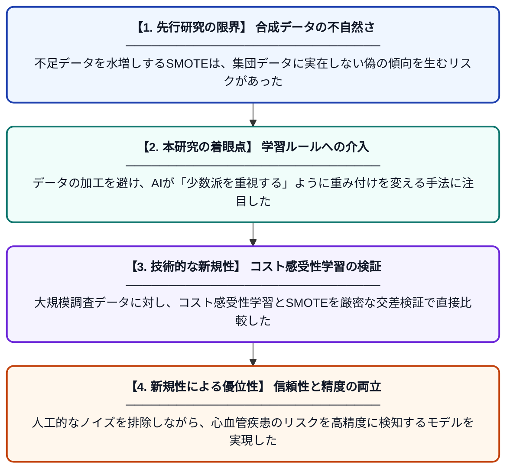

# 心血管疾患リスクスクリーニングの最適化：コスト感受性学習とデータリサンプリングによるクラス不均衡の調整比較

**Original Title**: *1294-GRP Optimizing Cardiovascular Risk Screening: Balancing Class Imbalance via Cost-Sensitive Learning Versus Data Resampling, 2025 Behavioral Risk Factor …*

> **💡 一言要約**: AI診断の「データの偏り」を正す最適な学習法を解明

| 項目 | 内容 |
|---|---|
| **著者** | I Shahid, K Belcher |
| **掲載誌** | 2026 |
| **アラートキーワード** | SMOTE |
| **原文リンク** | [https://digitalcommons.kennesaw.edu/cday/Fall_2026/PhD_Research/25/](https://digitalcommons.kennesaw.edu/cday/Fall_2026/PhD_Research/25/) |
| **PDF版要約** | [README.pdf](./README.pdf) |

---

## 📊 新規性の図解（先行研究との違いと本研究のブレークスルー）

## 📝 要約

心血管疾患のリスク予測において、疾患ありのデータが少ない「クラス不均衡」を解消する手法を比較検証した研究です。従来主流のSMOTE（データ合成）が持つ人工的なノイズのリスクを指摘し、アルゴリズム側で誤診の重みを調整するコスト感受性学習の有効性を大規模データで評価しています。

## ❓ どんな問題に取り組んだか

医療データでは「病気の人」が「健康な人」に比べて極端に少ないため、AIが多数派の健康な人ばかりを正解と学習してしまう問題があります。これを解決するために架空のデータを生成するSMOTE手法が使われますが、実在しない不自然なデータが混入し、診断の信頼性を損なうリスクがありました。

## ✨ 何が新しい？何がすごい？（新規性）

本研究は、データそのものを加工するのではなく、AIの学習過程で「病気を見逃した際のペナルティ」を重くするコスト感受性学習の優位性を明らかにしました。2025年の行動リスク要因監視システム（BRFSS）データを用い、10分割交差検証を通じて、SMOTEが引き起こすアーティファクト（人工的な不自然さ）を排除しつつ予測精度を維持・向上させるパイプラインを確立しました。これにより、集団の健康データが持つ本来の特徴を損なわずに高精度なスクリーニングが可能であることを示しました。

## 🎓 大学1年生向けの解説

AIを使って病気の予兆を見つけるとき、データの中に「病気の人」が少ないと、AIは全員を「健康」と診断したほうが正解率が高くなると勘違いしてしまいます。これを防ぐために、これまではニセのデータを増やしてバランスを取っていましたが、それではデータの正確さが失われる心配がありました。この研究では、ニセデータを使わずに「病気を見逃したら重いペナルティを与える」という学習ルールを使い、より安全で正確に診断できる方法を見つけ出しました。
