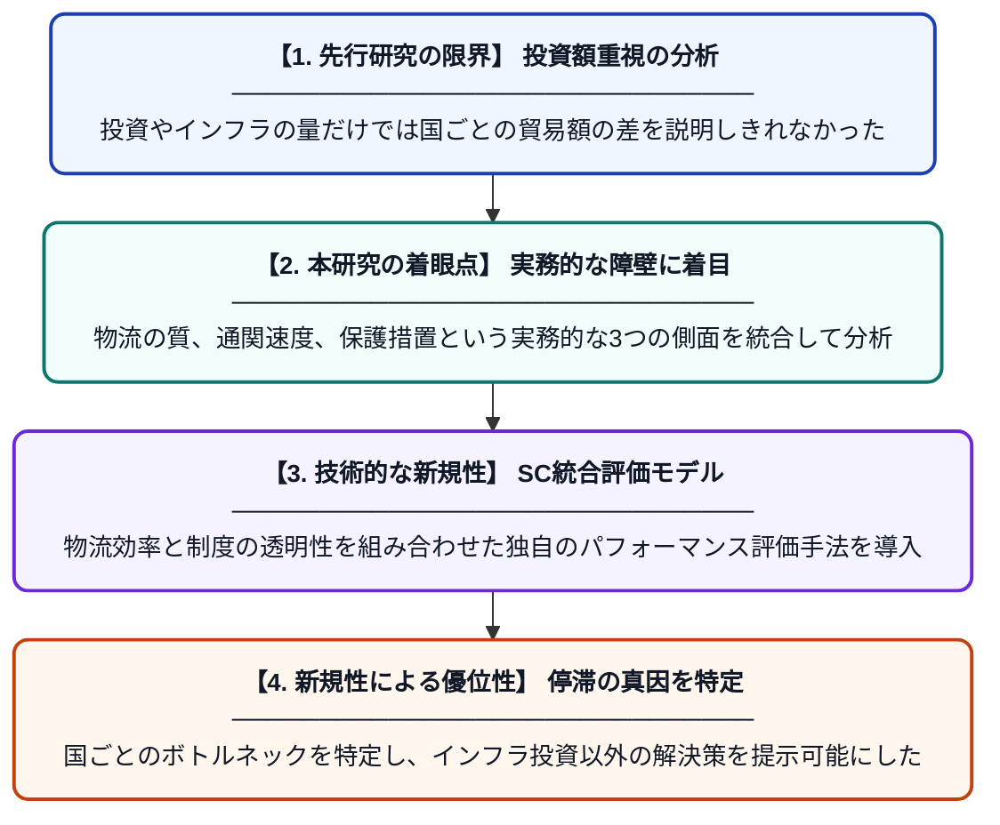

# 中国とASEAN諸国間の農産物貿易サプライチェーンのパフォーマンス：物流・通関・保護条件との関連性

**Original Title**: *Agricultural trade supply chain performance between China and ASEAN countries and its association with logistics, customs and safeguard conditions*

> **💡 一言要約**: 中国・ASEAN貿易の壁を物流と通関から解明

| 項目 | 内容 |
|---|---|
| **著者** | J Lu, SC Chuah, D Lu, WB Kang, YD Wu, J Gary… |
| **掲載誌** | Cogent Food & Agriculture 2026 |
| **アラートキーワード** | logistics |
| **PDF** | [https://www.tandfonline.com/doi/pdf/10.1080/23311932.2026.2760067](https://www.tandfonline.com/doi/pdf/10.1080/23311932.2026.2760067) |
| **原文リンク** | [https://www.tandfonline.com/doi/pdf/10.1080/23311932.2026.2760067](https://www.tandfonline.com/doi/pdf/10.1080/23311932.2026.2760067) |
| **PDF版要約** | [README.pdf](./README.pdf) |

---

## 📊 新規性の図解（先行研究との違いと本研究のブレークスルー）

## 📝 要約

本研究は、中国とASEAN諸国間の農産物貿易におけるサプライチェーンの効率性を定量的に分析したものです。インフラや政策的な結びつきがあるにもかかわらず国ごとに貿易額が異なる要因を、物流の質、通関手続き、および貿易保護措置の観点から明らかにしました。

## ❓ どんな問題に取り組んだか

中国とASEANの間には強力な経済的・政治的結びつきが存在しますが、実際の農産物貿易の成果には国によって大きなばらつきがあります。なぜ同様の投資や協力体制があっても貿易パフォーマンスに差が出るのか、その背後にある物流や制度上のボトルネックが十分に解明されていませんでした。

## ✨ 何が新しい？何がすごい？（新規性）

本研究の新規性は、投資額などのマクロな指標だけでなく、物流の質、通関の迅速さ、セーフガード条件という実務的な3要素を統合して評価した点にあります。先行研究がインフラ整備に重点を置いていたのに対し、本研究は非関税障壁や制度運用の効率性が貿易成果に与える影響を具体的なデータで示しました。これにより、国ごとのサプライチェーンの弱点を特定し、実効性の高い政策提言を行っている点が画期的です。

## 🎓 大学1年生向けの解説

中国と東南アジア（ASEAN）の間では、野菜や果物などの農産物がさかんにやり取りされています。しかし、同じように協力していても、取引がスムーズな国もあれば、そうでない国もあります。この研究では、「荷物を運ぶトラックや船の便利さ」や「税関での手続きの速さ」がどれくらい貿易に影響しているかを調べました。その結果、単にお金を出すだけでなく、ルールを分かりやすくしたり手続きを速くしたりすることが、貿易を増やすためにとても重要だとわかりました。
