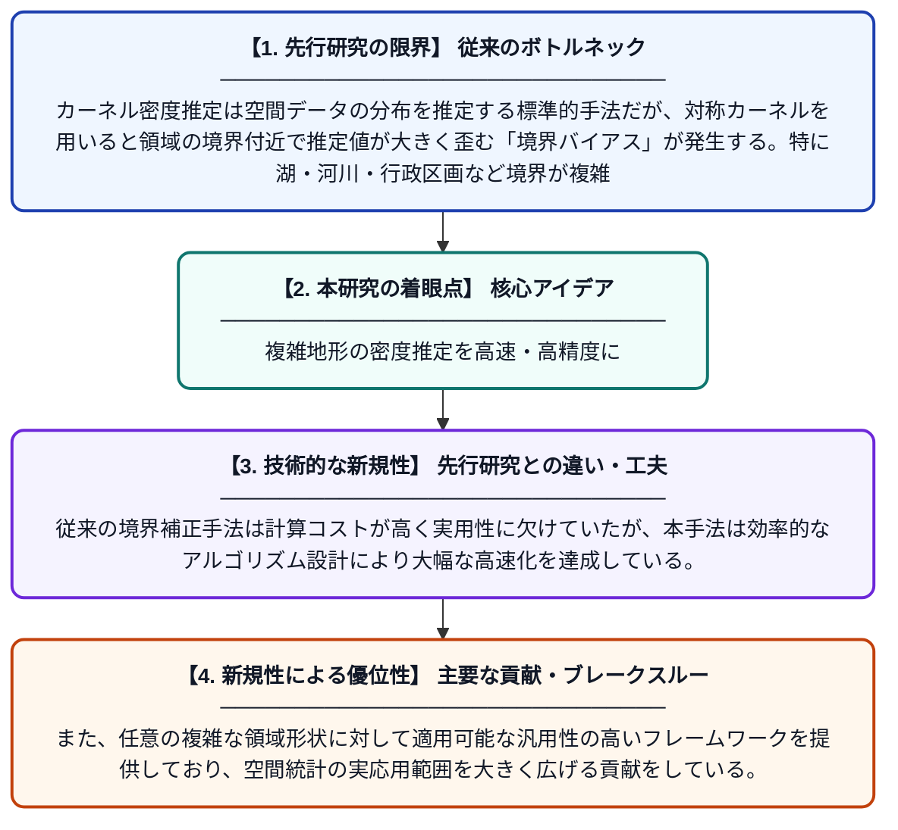

# 複雑な領域における境界を考慮した高速空間強度推定

**Original Title**: *Fast boundary-aware spatial intensity estimation on complex domains*

> **💡 一言要約**: 複雑地形の密度推定を高速・高精度に

| 項目 | 内容 |
|---|---|
| **著者** | T Nakagawa, K Takanashi, K McAlinn, T Kanamori |
| **掲載誌** | arXiv preprint arXiv:2607.22366 2026 |
| **アラートキーワード** | kernel density estimation |
| **PDF** | [https://arxiv.org/pdf/2607.22366](https://arxiv.org/pdf/2607.22366) |
| **原文リンク** | [https://arxiv.org/abs/2607.22366](https://arxiv.org/abs/2607.22366) |
| **PDF版要約** | [README.pdf](./README.pdf) |

---

## 📊 新規性の図解（先行研究との違いと本研究のブレークスルー）

## 📝 要約

この論文は、複雑な形状の領域（例えば、湖や道路ネットワークなど）でカーネル密度推定を行う際に生じる「境界バイアス」問題を解決する手法を提案している。拡散カーネルを用いることで領域の境界を適切に考慮しながら、計算効率よく空間強度を推定する新しいアルゴリズムを開発した。これにより、従来手法では難しかった複雑な形状領域での空間統計解析が実用的な速度で実現可能となる。

## ❓ どんな問題に取り組んだか

カーネル密度推定は空間データの分布を推定する標準的手法だが、対称カーネルを用いると領域の境界付近で推定値が大きく歪む「境界バイアス」が発生する。特に湖・河川・行政区画など境界が複雑な形状を持つ領域では、この問題が深刻で、かつ計算コストも膨大になるという二重の困難があった。

## ✨ 何が新しい？何がすごい？（新規性）

本研究は、拡散過程に基づくカーネル（拡散カーネル）を活用することで、複雑な領域形状に自然に適合した境界補正を実現した点が新しい。従来の境界補正手法は計算コストが高く実用性に欠けていたが、本手法は効率的なアルゴリズム設計により大幅な高速化を達成している。また、任意の複雑な領域形状に対して適用可能な汎用性の高いフレームワークを提供しており、空間統計の実応用範囲を大きく広げる貢献をしている。

## 🎓 大学1年生向けの解説

地図上でどこに多くの人や動物が集まっているかを推定したいとき、「カーネル密度推定」という数学的な方法を使います。しかし、湖や公園のように境界線がある場所では、境界の近くで推定値が実態よりずれてしまうという問題があります。この論文は、熱が広がる現象（拡散）をモデルに使うことで、境界の影響を自動的に補正する賢い方法を考案しました。さらに、その計算を速く行う工夫もしているので、複雑な形の地域でも実際に使えるツールになっています。
