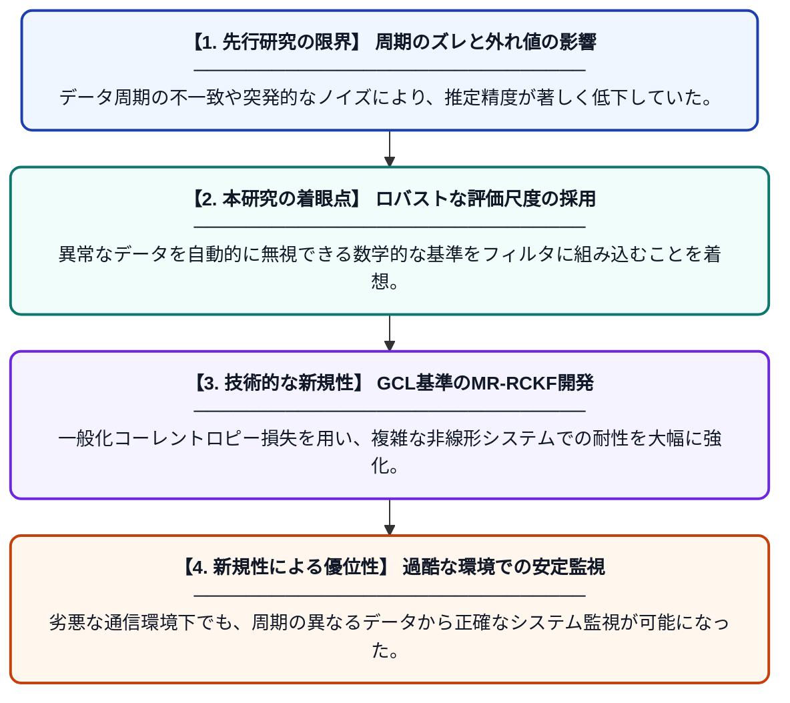

# マルチレート計測を用いる電力系統状態推定のためのロバスト求積カルマンフィルタ

**Original Title**: *Robust Cubature Kalman Filter for Power System State Estimation With Multi‐Rate Measurements*

> **💡 一言要約**: 多様なデータ周期とノイズに強い最新の電力系統監視術

| 項目 | 内容 |
|---|---|
| **著者** | S Du, J Wang, H Gu, P Zhao, S Feng, B Chen |
| **掲載誌** | IET Control Theory & Applications 2026 |
| **アラートキーワード** | kalman filter |
| **原文リンク** | [https://search.proquest.com/openview/464c29f19ede3a2beaee8fb15f8fc1a3/1?pq-origsite=gscholar&cbl=1936359](https://search.proquest.com/openview/464c29f19ede3a2beaee8fb15f8fc1a3/1?pq-origsite=gscholar&cbl=1936359) |
| **PDF版要約** | [README.pdf](./README.pdf) |

---

## 📊 新規性の図解（先行研究との違いと本研究のブレークスルー）

## 📝 要約

電力系統において更新周期が異なる複数の計測データが混在する「マルチレート」環境に対応し、かつ外れ値などのノイズに強い状態推定手法を提案しました。一般化コーレントロピー損失（GCL）を求積カルマンフィルタに導入することで、非ガウスノイズ下でも高精度な推定を可能にしています。

## ❓ どんな問題に取り組んだか

電力系統では、サンプリング周期が異なる計測機器が混在しており、これらを統合して計算する際に精度が低下する課題がありました。また、通信不良等による異常な値（外れ値）が混じると、従来の推定アルゴリズムでは計算結果が大きく狂ってしまうという問題がありました。

## ✨ 何が新しい？何がすごい？（新規性）

本研究の核心は、求積カルマンフィルタ（CKF）に「一般化コーレントロピー損失（GCL）」というロバストな統計基準を統合した点にあります。これにより、従来のガウス分布を前提とした手法では対応できなかった鋭いノイズを効果的に排除できるようになりました。マルチレート処理とロバスト性を両立させることで、現実的で複雑な電力網の状態把握をより確実なものにしています。

## 🎓 大学1年生向けの解説

電気が安定して届くようにするためには、電力ネットワークの「今の状態」を常に監視する必要があります。しかし、データの届くタイミングがバラバラだったり、通信ミスでデタラメな数字が混ざったりすると、コンピュータは混乱してしまいます。この研究では、そうしたバラバラなデータや怪しい数字を賢く処理して、正確に状態を突き止めるための新しい計算ルールを開発しました。
