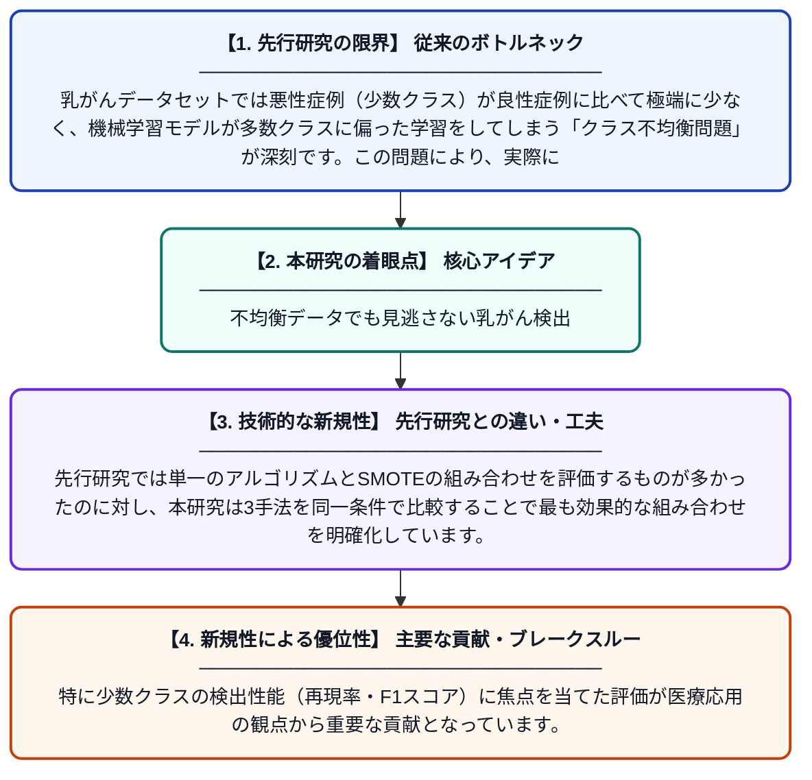

# SMOTEとSVM・AdaBoostを用いた乳がんデータセットにおける少数クラス検出の改善

**Original Title**: *Improving Minority Class Detection in Breast Cancer Dataset using SMOTE with SVM and Adaboost*

> **💡 一言要約**: 不均衡データでも見逃さない乳がん検出

| 項目 | 内容 |
|---|---|
| **著者** | U Rafflesia |
| **掲載誌** | International Conference on Religion, Science and Education 2026 |
| **アラートキーワード** | SMOTE |
| **PDF** | [https://sunankalijaga.org/prosiding/index.php/icrse/article/download/1885/1458](https://sunankalijaga.org/prosiding/index.php/icrse/article/download/1885/1458) |
| **原文リンク** | [https://sunankalijaga.org/prosiding/index.php/icrse/article/download/1885/1458](https://sunankalijaga.org/prosiding/index.php/icrse/article/download/1885/1458) |
| **PDF版要約** | [README.pdf](./README.pdf) |

---

## 📊 新規性の図解（先行研究との違いと本研究のブレークスルー）

## 📝 要約

本研究は、乳がん診断データにおけるクラス不均衡問題に対処するため、データ拡張手法であるSMOTEをSVM・決定木・AdaBoostの3つの分類アルゴリズムと組み合わせた効果を検証したものです。SMOTEを適用することで少数クラス（悪性腫瘍）の検出精度がどの程度向上するかを定量的に評価しています。特にSVMとAdaBoostとの組み合わせが少数クラスの検出改善に有効であることを示しています。

## ❓ どんな問題に取り組んだか

乳がんデータセットでは悪性症例（少数クラス）が良性症例に比べて極端に少なく、機械学習モデルが多数クラスに偏った学習をしてしまう「クラス不均衡問題」が深刻です。この問題により、実際に最も重要な悪性腫瘍の見逃し（偽陰性）が増加し、医療現場での実用性が損なわれます。

## ✨ 何が新しい？何がすごい？（新規性）

本研究の新規性は、SMOTEと複数の異なる分類アルゴリズム（SVM・決定木・AdaBoost）を組み合わせて体系的に比較評価した点にあります。先行研究では単一のアルゴリズムとSMOTEの組み合わせを評価するものが多かったのに対し、本研究は3手法を同一条件で比較することで最も効果的な組み合わせを明確化しています。特に少数クラスの検出性能（再現率・F1スコア）に焦点を当てた評価が医療応用の観点から重要な貢献となっています。

## 🎓 大学1年生向けの解説

乳がんの診断データには「悪性（がん）」のサンプルが「良性（がんでない）」より少ないという偏りがあります。AIにそのまま学習させると、少ない悪性ケースを見逃しやすくなってしまいます。そこで「SMOTE」という技術で人工的に少数データを増やし、AIが公平に学習できるようにします。本研究では、このSMOTEをSVMやAdaBoostなど3種類のAIと組み合わせて、どれが最もがんを見逃さないかを比較・検証しました。
