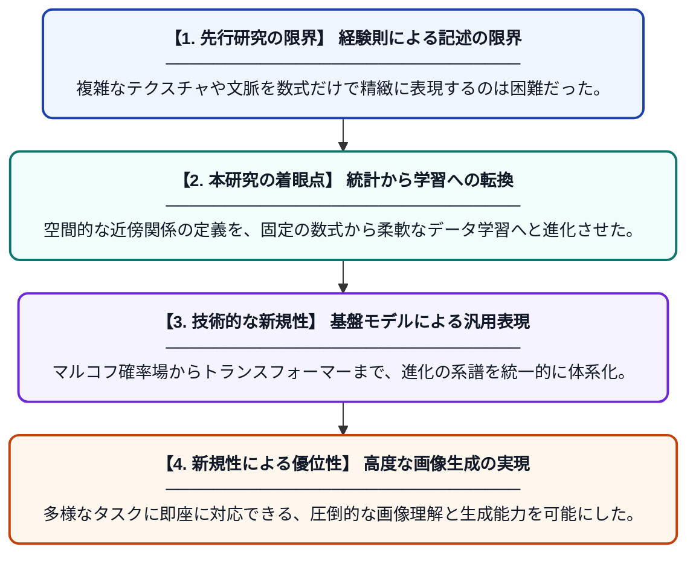

# 画像モデリング：手作業による事前分布から画像基盤モデルまで

**Original Title**: *Image modeling: From handcrafted priors to foundation image models*

> **💡 一言要約**: 画像モデルの進化を辿る決定版ガイド

| 項目 | 内容 |
|---|---|
| **著者** | AM Tekalp |
| **掲載誌** | arXiv preprint arXiv:2610.36646 2026 |
| **アラートキーワード** | Markov random"  fields |
| **PDF** | [https://arxiv.org/pdf/2610.36646](https://arxiv.org/pdf/2610.36646) |
| **原文リンク** | [https://arxiv.org/pdf/2610.36646](https://arxiv.org/pdf/2610.36646) |
| **PDF版要約** | [README.pdf](./README.pdf) |

---

## 📊 新規性の図解（先行研究との違いと本研究のブレークスルー）

## 📝 要約

画像処理におけるモデリング手法の進化を、古典的なマルコフ確率場（MRF）などの手動設計によるアプローチから、最新の深層学習ベースの基盤モデルまで包括的に解説しています。空間的な文脈理解がどのように発展し、現在の生成AIや大規模モデルに至ったかの歴史的な系譜を明らかにしています。

## ❓ どんな問題に取り組んだか

従来の画像処理は、画素間の関係性を数式で定義する「手作業のルール」に依存しており、複雑な実世界の画像を完全に表現するには限界がありました。大規模データと計算資源が増大する中で、これらの古典的手法と現代の強力なデータ駆動型モデルをどう結びつけるかが課題となっていました。

## ✨ 何が新しい？何がすごい？（新規性）

本論文は、数十年にわたる画像モデリングの変遷を体系化し、特に古典的な確率モデルと現代のトランスフォーマー等の基盤モデルの連続性を再定義しました。単なる手法の羅列ではなく、空間的な文脈理解という一貫した視点から、生成AIの核心となる技術的背景を統合的に説明している点が画期的です。これにより、最新モデルの設計思想が古典的な知見にどう根ざしているかを解明しました。

## 🎓 大学1年生向けの解説

デジカメの写真を綺麗にしたりAIで画像を作ったりするには、「画像とは何か」をコンピュータに教える必要があります。昔は「隣り合う画素は色が似ているはずだ」といったルールを人間が一生懸命考えて教えていました。しかし現在は、AIが膨大なデータから自分でルールを見つけ出す「基盤モデル」というものが主流です。この論文は、その教え方が時代とともにどう賢くなってきたかを、歴史を追って教えてくれる教科書のような内容です。
