# コード最適化のための強化学習

**Original Title**: *Reinforcement Learning for Code Optimization*

> **💡 一言要約**: AIがコードを自動で高速化する

| 項目 | 内容 |
|---|---|
| **著者** | P Chambon, K Zheng, J Decugis, B Sagot, G Synnaeve |
| **掲載誌** | arXiv preprint arXiv:2607.25970 2026 |
| **アラートキーワード** | optimization |
| **PDF** | [https://arxiv.org/pdf/2607.25970](https://arxiv.org/pdf/2607.25970) |
| **Git リポジトリ** | [https://github.com/containers/bubblewrap](https://github.com/containers/bubblewrap) |
| **原文リンク** | [https://arxiv.org/pdf/2607.25970](https://arxiv.org/pdf/2607.25970) |
| **PDF版要約** | [README.pdf](./README.pdf) |

---

## 📊 新規性の図解（先行研究との違いと本研究のブレークスルー）

```mermaid
%%{init: {'flowchart': {'wrappingWidth': 520, 'nodeSpacing': 18, 'rankSpacing': 28, 'padding': 14, 'curve': 'basis'}, 'themeVariables': {'fontSize': '14px'}}}%%
flowchart TD
    S1["<b>【1. 先行研究の限界】 従来のボトルネック</b><br/>──────────────────────────────<br/>プログラムのコードを手動で最適化することは時間と専門知識を要する困難な作業です。既存の大規模言語モデルはコード生成は得意ですが、実行速度を意識した最適化を体系的に行う能力は十分に評"]
    S2["<b>【2. 本研究の着眼点】 核心アイデア</b><br/>──────────────────────────────<br/>AIがコードを自動で高速化する"]
    S3["<b>【3. 技術的な新規性】 先行研究との違い・工夫</b><br/>──────────────────────────────<br/>従来の研究が主にコードの正確性や生成品質に注目していたのに対し、本研究は実行速度の改善を直接最適化対象としています。"]
    S4["<b>【4. 新規性による優位性】 主要な貢献・ブレークスルー</b><br/>──────────────────────────────<br/>較正済みサンドボックス環境により、実行時間測定のノイズを抑えた信頼性の高い評価を実現しました。 これにより、最適化を意識したモデルが実際にどれほど有効かを定量的に示しました。"]
    S1 --> S2
    S2 --> S3
    S3 --> S4
    style S1 fill:#EFF6FF,stroke:#1E40AF,stroke-width:2px,color:#111827,rx:8,ry:8
    style S2 fill:#F0FDFA,stroke:#0F766E,stroke-width:2px,color:#111827,rx:8,ry:8
    style S3 fill:#F5F3FF,stroke:#6D28D9,stroke-width:2px,color:#111827,rx:8,ry:8
    style S4 fill:#FFF7ED,stroke:#C2410C,stroke-width:2px,color:#111827,rx:8,ry:8
```

## 📝 要約

本論文は、強化学習をコードの実行時間最適化に応用する手法を提案しています。大規模な最適化テストと較正済みサンドボックスを用いたベンチマーク「DMC-Optim」を構築し、モデルの最適化能力を評価しています。実行時間を報酬信号として活用することで、コードを自動的に高速化するAIシステムの有効性を検証しています。

## ❓ どんな問題に取り組んだか

プログラムのコードを手動で最適化することは時間と専門知識を要する困難な作業です。既存の大規模言語モデルはコード生成は得意ですが、実行速度を意識した最適化を体系的に行う能力は十分に評価・活用されていませんでした。実行時間という動的なフィードバックをどう学習に組み込むかが課題でした。

## ✨ 何が新しい？何がすごい？（新規性）

本研究は、コード最適化タスクに特化したベンチマーク「DMC-Optim」を新たに構築し、実行時間を報酬とする強化学習フレームワークを提案した点が新しいです。従来の研究が主にコードの正確性や生成品質に注目していたのに対し、本研究は実行速度の改善を直接最適化対象としています。較正済みサンドボックス環境により、実行時間測定のノイズを抑えた信頼性の高い評価を実現しました。これにより、最適化を意識したモデルが実際にどれほど有効かを定量的に示しました。

## 🎓 大学1年生向けの解説

プログラムには「速いコード」と「遅いコード」があり、同じ動作でも書き方によって実行時間が大きく変わります。この研究では、AIに「コードを速くしたら褒める」というゲームのような仕組み（強化学習）を使って、自動的に速いコードを書けるよう学習させています。まるでAIが何度もコードを書き直して、タイムアタックで最速を目指すようなイメージです。実験のために公平な計測環境も整備し、どのAIが本当にコードを速くできるかを正しく比べられるようにしました。
