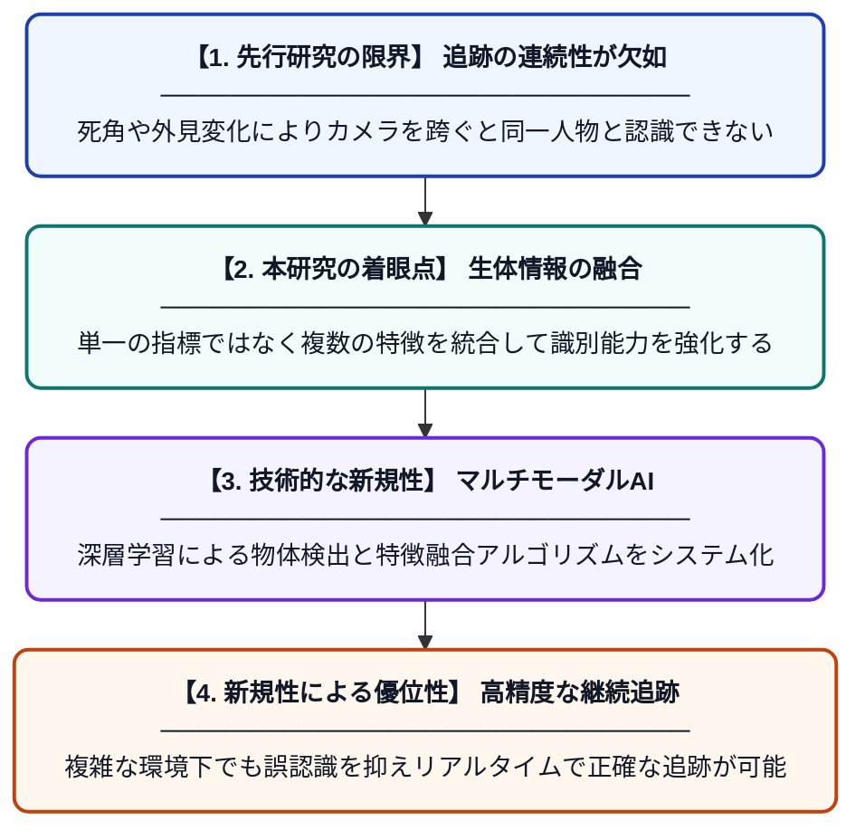

# ディープラーニングと生体認証の融合によるマルチモーダルな人物再識別

**Original Title**: *Multimodal Person Re-Identification Using Deep Learning and Biometric Fusion*

> **💡 一言要約**: AIと生体情報で迷わず追跡する次世代監視技術

| 項目 | 内容 |
|---|---|
| **著者** | K Keerthana, S Sethupathi, P Kanishka, M Nishanthini… |
| **掲載誌** | … International Conference on … 2026 |
| **アラートキーワード** | Multi Camera Tracking |
| **原文リンク** | [https://ieeexplore.ieee.org/abstract/document/11736747/](https://ieeexplore.ieee.org/abstract/document/11736747/) |
| **PDF版要約** | [README.pdf](./README.pdf) |

---

## 📊 新規性の図解（先行研究との違いと本研究のブレークスルー）

## 📝 要約

広範囲に設置された複数のカメラを通じて特定の人物を追跡する技術について、ディープラーニングと生体認証を組み合わせた手法を提案しています。物体検出や追跡技術を統合することで、カメラの視点が変わっても同一人物を高い精度で特定し続けることを目指した研究です。

## ❓ どんな問題に取り組んだか

広大な環境に設置された多数のカメラ映像において、人物が異なるカメラ間を移動する際に同一人物として認識し続けることは困難です。照明の変化や服装の類似、カメラ角度の違いにより、従来の追跡システムでは頻繁に見失いや誤認識が発生していました。

## ✨ 何が新しい？何がすごい？（新規性）

本研究の核心は、単一の手法に頼らず、ディープラーニングを用いた物体検出と複数の生体情報を組み合わせる「マルチモーダル融合」を採用した点にあります。この統合アプローチにより、外見の一時的な変化や環境ノイズに左右されない強力な特徴抽出が可能になりました。先行研究と比較して、死角の多い複雑な環境下での再識別精度が大幅に向上しており、リアルタイム追跡の実用性を大きく前進させました。

## 🎓 大学1年生向けの解説

ショッピングモールのような広い場所で、たくさんのカメラを切り替えながら特定の人物を追い続けるのは、実はAIにとっても非常に難しい課題です。この研究では、AIが「服の色」だけでなく「顔」や「体の特徴」など複数の情報をセットで覚えることで、見間違いを減らす工夫をしています。これにより、人がカメラの死角に入って別のカメラに映ったときでも、自動で同じ人だと正しく判断できるようになります。防犯や迷子探しをより確実に。する画期的な技術です。
