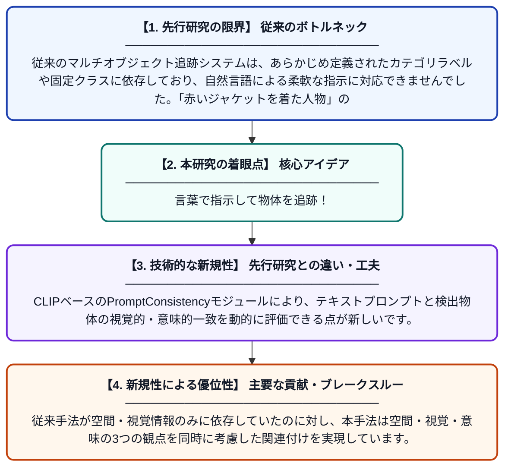

# 空間・視覚・意味的関連付けの統合による自然言語駆動型マルチオブジェクト追跡

**Original Title**: *Natural Language Driven Multi-Object Tracking via Joint Spatial, Visual, and Semantic Association*

> **💡 一言要約**: 言葉で指示して物体を追跡！

| 項目 | 内容 |
|---|---|
| **著者** | A Hasan, A Richardson, G Karsai |
| **掲載誌** | 2026 IEEE International Conference on Smart Computing 2026 |
| **アラートキーワード** | Open-Vocabulary Object ... |
| **原文リンク** | [https://ieeexplore.ieee.org/abstract/document/11627450/](https://ieeexplore.ieee.org/abstract/document/11627450/) |
| **PDF版要約** | [README.pdf](./README.pdf) |

---

## 📊 新規性の図解（先行研究との違いと本研究のブレークスルー）

## 📝 要約

本論文は、自然言語の指示文を用いて映像中の複数の物体を同時に追跡する手法を提案しています。オープン語彙物体検出とByteTrackによる時系列関連付けを組み合わせ、CLIPベースのPromptConsistencyモジュールにより意味的整合性を確保します。さらにBERTを活用して、テキスト記述と検出物体の意味的マッチングを実現しています。

## ❓ どんな問題に取り組んだか

従来のマルチオブジェクト追跡システムは、あらかじめ定義されたカテゴリラベルや固定クラスに依存しており、自然言語による柔軟な指示に対応できませんでした。「赤いジャケットを着た人物」のような複雑なテキスト記述で任意の物体を追跡することは困難な課題でした。

## ✨ 何が新しい？何がすごい？（新規性）

本研究は、オープン語彙検出・ByteTrackによる時系列追跡・CLIPとBERTを組み合わせた意味的整合性モジュールを統合した初めての包括的フレームワークを提案しています。CLIPベースのPromptConsistencyモジュールにより、テキストプロンプトと検出物体の視覚的・意味的一致を動的に評価できる点が新しいです。従来手法が空間・視覚情報のみに依存していたのに対し、本手法は空間・視覚・意味の3つの観点を同時に考慮した関連付けを実現しています。

## 🎓 大学1年生向けの解説

例えば監視カメラの映像で「青いリュックを背負った人物を追いかけて」と言葉で指示するだけで、コンピュータがその人物を自動的に追跡できる技術です。これまでのシステムは「人間」「車」などあらかじめ決まった種類しか認識できませんでしたが、この研究では自然な言葉の説明でどんな物体でも追跡できるようにしました。言語を理解するAI（BERT）と画像と言葉を結びつけるAI（CLIP）を組み合わせることで、言葉の意味と映像の内容を照合しています。まるでスポーツ中継で「3番の選手を追え」と指示するように、柔軟な物体追跡が可能になります。
