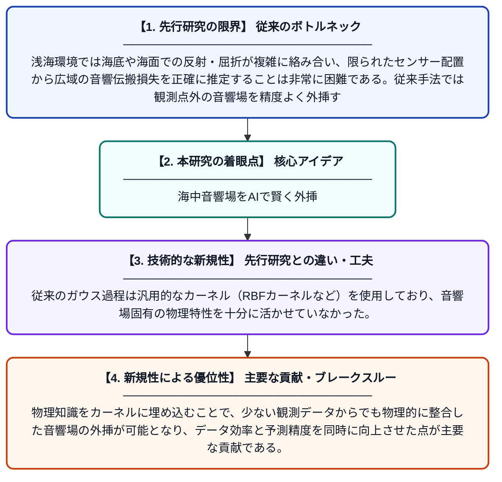

# 正規モードに基づくカーネルを用いたガウス過程による浅海音響場外挿

**Original Title**: *Acoustic field extrapolation in shallow water using Gaussian process with Normal-Mode-Based Kernel*

> **💡 一言要約**: 海中音響場をAIで賢く外挿

| 項目 | 内容 |
|---|---|
| **著者** | A Yang, P Xiao, Z Hou, Z Li |
| **掲載誌** | JASA Express Letters 2026 |
| **アラートキーワード** | gaussian process |
| **原文リンク** | [https://pubs.aip.org/asa/jel/article/6/7/070801/3399216](https://pubs.aip.org/asa/jel/article/6/7/070801/3399216) |
| **PDF版要約** | [README.pdf](./README.pdf) |

---

## 📊 新規性の図解（先行研究との違いと本研究のブレークスルー）

## 📝 要約

本研究は、浅海における伝搬損失の再構築において音響場の外挿問題に取り組むため、正規モードに基づくカーネルを組み込んだガウス過程回帰フレームワークを提案する。2024年の南シナ海実験環境のシミュレーションを基に手法の有効性を検証し、限られた観測データから未観測領域の音響場を高精度に推定することを実現した。これにより、海中音響モニタリングや通信における実用的な音場推定の改善が期待される。

## ❓ どんな問題に取り組んだか

浅海環境では海底や海面での反射・屈折が複雑に絡み合い、限られたセンサー配置から広域の音響伝搬損失を正確に推定することは非常に困難である。従来手法では観測点外の音響場を精度よく外挿することが難しく、海中音響通信や環境モニタリングの精度向上が課題となっていた。

## ✨ 何が新しい？何がすごい？（新規性）

本研究の新規性は、機械学習のガウス過程回帰に対して、浅海音響学の物理理論である「正規モード理論」を基盤とするカーネル関数を組み込んだ点にある。従来のガウス過程は汎用的なカーネル（RBFカーネルなど）を使用しており、音響場固有の物理特性を十分に活かせていなかった。物理知識をカーネルに埋め込むことで、少ない観測データからでも物理的に整合した音響場の外挿が可能となり、データ効率と予測精度を同時に向上させた点が主要な貢献である。

## 🎓 大学1年生向けの解説

海の中で音がどのように伝わるかを調べるとき、すべての場所にマイクを置くことはできません。そこでこの研究では、少ない測定点のデータから、測っていない場所の音の大きさをコンピューターで予測する方法を開発しました。ポイントは、「ガウス過程」という統計的な機械学習手法に、海の中での音の伝わり方に関する物理の知識を組み合わせたことです。物理の知識をAIに教え込むことで、少ないデータでも正確に音響場を再現できるようになりました。
