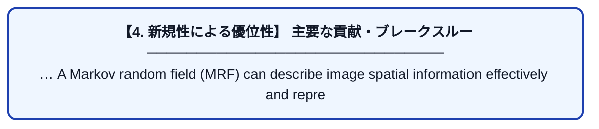

# Spatiotemporal consistency correction of multi-temporal GlobeLand30 land-cover products using a texture-informed MAP–MRF model

| 項目 | 内容 |
|---|---|
| **著者** | G Wang, L Hou, L Zheng, J Wang, Z Zhao |
| **掲載誌** | International Journal of Remote Sensing 2026 |
| **アラートキーワード** | MRFs Markov |
| **原文リンク** | [https://www.tandfonline.com/doi/abs/10.1080/01431161.2026.2753093](https://www.tandfonline.com/doi/abs/10.1080/01431161.2026.2753093) |
| **PDF版要約** | [README.pdf](./README.pdf) |

---

## 📊 新規性の図解（先行研究との違いと本研究のブレークスルー）

## 📝 要約

… A Markov random field (MRF) can describe image spatial information effectively and represent the spatial dependence of land-cover classes (G. Liu … Therefore, an MRF model can optimize classification results by using image-context information …
