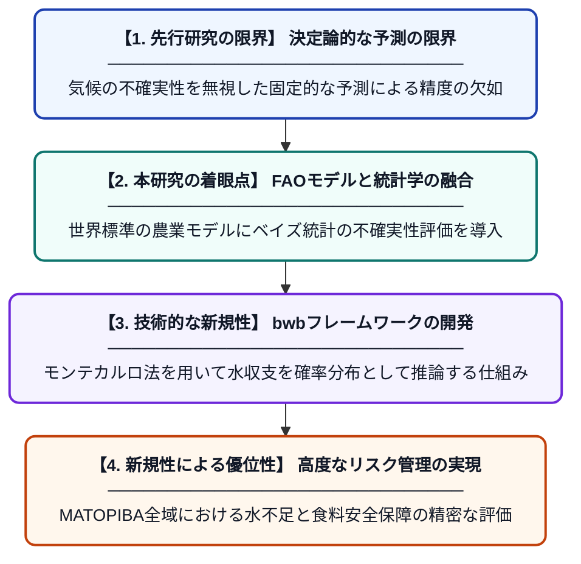

# MATOPIBA地域における水資源管理と食料安全保障のための確率論的モデリング

**Original Title**: *Probabilistic modeling for water resources management and food security in MATOPIBA*

> **💡 一言要約**: ベイズ統計で水不足リスクを確率的に予測し農業を守る

| 項目 | 内容 |
|---|---|
| **著者** | ÂSMC Soares, CD Maciel, PAA Marques |
| **掲載誌** | 2026 |
| **アラートキーワード** | MCMC |
| **原文リンク** | [https://repositorio.usp.br/item/003333026](https://repositorio.usp.br/item/003333026) |
| **PDF版要約** | [README.pdf](./README.pdf) |

---

## 📊 新規性の図解（先行研究との違いと本研究のブレークスルー）

## 📝 要約

ブラジルの主要な農業フロンティアであるMATOPIBAを対象に、FAOの水収支モデルとベイズ統計学を統合した「bwb」フレームワークを提案しました。気候の不確実性を考慮した確率的なアプローチにより、農業生産に不可欠な水資源のより精密な管理とリスク評価を可能にしています。

## ❓ どんな問題に取り組んだか

MATOPIBA地域はブラジルの重要な農業拠点ですが、気候変動による降雨パターンの不安定さが食料生産に大きなリスクをもたらしています。従来の水収支モデルでは、気候の不確実性や予測の誤差を十分に考慮できず、現実的な意思決定を支えるための精度が不足していました。

## ✨ 何が新しい？何がすごい？（新規性）

国連食糧農業機関（FAO）の標準的な水収支モデルに、ベイズ統計推論とモンテカルロ法を組み合わせた「bwb」フレームワークを開発した点が画期的です。これにより、単一の予測値ではなく「不確実性を伴う確率分布」として水収支を計算できるようになり、極端な気象イベントが食料安全保障に与える影響をより高い精度で評価できるようになりました。特定の地域に最適化された確率論的アプローチは、広大な農地における水資源管理に新たな科学的基準を提示しています。

## 🎓 大学1年生向けの解説

ブラジルの巨大な農地において、農作物を育てるために最も大切な「水」が将来どれくらい使えるかを予測する研究です。これまでは「だいたいこれくらい」という大まかな予想しかできませんでしたが、この研究では「ベイズ統計」という数学の手法を使って、水が足りなくなる確率をより細かく計算できるようにしました。天気予報が「降水確率」を出すように、農業でも「水不足の確率」を正確に知ることで、農家の人たちが将来の計画を立てやすくなります。
