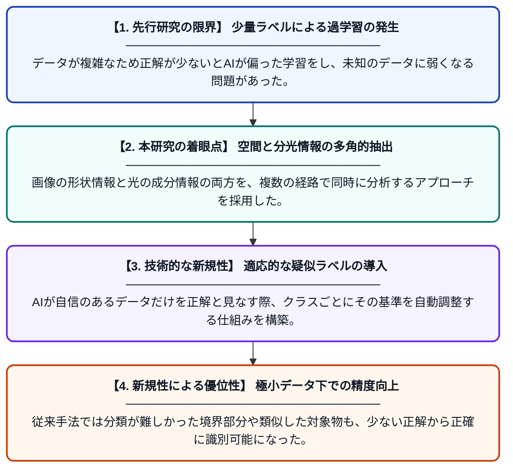

# マルチブランチ空間・分光エンコーディングと適応的クラス認識疑似ラベルを用いた半教師ありハイパースペクトル画像分類フレームワーク

**Original Title**: *… Framework with Multi-Branch Spatial–Spectral Encoding and Adaptive Class-Aware Pseudo-Labeling for Semi-Supervised Hyperspectral Image Classification*

> **💡 一言要約**: 少数のラベルで高次元画像を精密に分類する新手法

| 項目 | 内容 |
|---|---|
| **著者** | W Jiang, J Wang, H Yuan |
| **掲載誌** | Entropy 2026 |
| **アラートキーワード** | Semi supervise |
| **原文リンク** | [https://www.mdpi.com/1099-4300/28/11/1221](https://www.mdpi.com/1099-4300/28/11/1221) |
| **PDF版要約** | [README.pdf](./README.pdf) |

---

## 📊 新規性の図解（先行研究との違いと本研究のブレークスルー）

## 📝 要約

この論文は、ラベル付きデータが極めて少ない状況でも高精度なハイパースペクトル画像分類を可能にする新しい学習フレームワーク「SEUM」を提案しています。空間情報と分光情報を多角的に抽出するエンコーダと、クラスごとに最適なしきい値を設定する疑似ラベル生成技術を組み合わせることで、データの有効活用を実現しました。

## ❓ どんな問題に取り組んだか

ハイパースペクトル画像はデータが非常に高次元である一方、専門知識が必要なアノテーション（ラベル付け）には多大なコストがかかります。そのため、教師データが不足する「小サンプル問題」が発生し、従来の深層学習モデルでは過学習や精度の低下が避けられないという課題がありました。

## ✨ 何が新しい？何がすごい？（新規性）

本研究の核心は、UniMatchという弱強一貫性フレームワークをベースに、空間と分光の情報を独立かつ統合的に抽出する「マルチブランチ・エンコーディング」を導入した点にあります。さらに、クラスごとの学習の難易度に合わせて確信度のしきい値を動的に調整する「適応的クラス認識疑似ラベル生成」を開発しました。これにより、ノイズの多い疑似ラベルを排除しつつ、ラベルなしデータから高品質な情報を効率的に学習することに成功しています。

## 🎓 大学1年生向けの解説

ハイパースペクトル画像とは、普通の写真よりもはるかに多くの「光の成分（波長）」を記録した超高性能な画像のことです。この画像は情報量が多すぎて、AIに「これは何の写真か」を教えるための正解データを作るのが非常に大変です。そこでこの研究では、わずかな正解データと大量の「正解がないデータ」を組み合わせて、AIが自ら学び取る賢い方法を開発しました。これにより、少しのヒントだけで複雑な画像の中身を正確に当てられるようになります。
