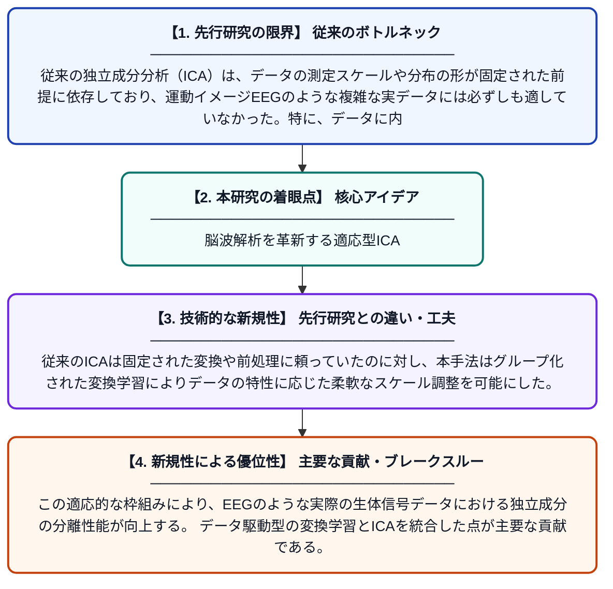

# AdaptICA: 独立成分分析のためのデータ適応型変換学習

**Original Title**: *AdaptICA: Data-Adaptive Transformation Learning for Independent Component Analysis*

> **💡 一言要約**: 脳波解析を革新する適応型ICA

| 項目 | 内容 |
|---|---|
| **著者** | L Jalili, J Liu, VD Calhoun, LH Lin |
| **掲載誌** | arXiv preprint arXiv:2607.21901 2026 |
| **アラートキーワード** | independent component ... |
| **PDF** | [https://arxiv.org/pdf/2607.21901](https://arxiv.org/pdf/2607.21901) |
| **原文リンク** | [https://arxiv.org/pdf/2607.21901](https://arxiv.org/pdf/2607.21901) |
| **PDF版要約** | [README.pdf](./README.pdf) |

---

## 📊 新規性の図解（先行研究との違いと本研究のブレークスルー）

## 📝 要約

本論文では、運動イメージEEG（脳波）の応用において観察された現象を動機として、データに適した測定スケールを自動的に学習する独立成分分析フレームワーク「AdaptICA」を提案している。グループ化された変換学習を通じて、従来のICAでは難しかった非線形なデータ構造にも対応できる柔軟な手法を実現している。これにより、脳波データの信号分離精度の向上が期待される。

## ❓ どんな問題に取り組んだか

従来の独立成分分析（ICA）は、データの測定スケールや分布の形が固定された前提に依存しており、運動イメージEEGのような複雑な実データには必ずしも適していなかった。特に、データに内在する非線形な構造や多様な分布形状を柔軟に捉えることが困難であり、信号分離の精度に限界があった。

## ✨ 何が新しい？何がすごい？（新規性）

AdaptICAは、ICAの前処理として適切なデータ変換（測定スケール）をデータ自身から自動的に学習するという新しいアプローチを採用している。従来のICAは固定された変換や前処理に頼っていたのに対し、本手法はグループ化された変換学習によりデータの特性に応じた柔軟なスケール調整を可能にした。この適応的な枠組みにより、EEGのような実際の生体信号データにおける独立成分の分離性能が向上する。データ駆動型の変換学習とICAを統合した点が主要な貢献である。

## 🎓 大学1年生向けの解説

人間の脳から取得した脳波（EEG）には、複数の異なる信号が混ざり合っています。独立成分分析（ICA）とは、その混ざった信号を元の独立した成分に分解する技術です。しかし従来の方法では、データの種類や形状に合わせた調整が難しいという問題がありました。この研究では、コンピューターがデータの特徴を自動的に学習して、最適な形にデータを変換してから分解する新しい方法「AdaptICA」を提案しています。これにより、脳波データをより正確に分析し、運動イメージ（体を動かすことを想像する）などの脳活動をより精密に解読できるようになります。
