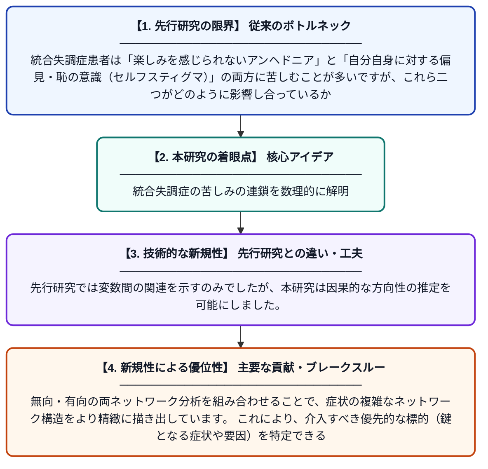

# ベイジアンネットワーク分析を用いた統合失調症におけるアンヘドニアとセルフスティグマの関係の解明

**Original Title**: *Disentangling Anhedonia and Self-Stigma in Schizophrenia Using Bayesian Network Analysis*

> **💡 一言要約**: 統合失調症の苦しみの連鎖を数理的に解明

| 項目 | 内容 |
|---|---|
| **著者** | J Chai, D Jiang, H Yang, L Liu, F Liu, W Pan, X Li |
| **掲載誌** | Alpha Psychiatry 2026 |
| **アラートキーワード** | bayesian network |
| **原文リンク** | [https://www.imrpress.com/journal/AP/27/4/10.31083/AP50731](https://www.imrpress.com/journal/AP/27/4/10.31083/AP50731) |
| **PDF版要約** | [README.pdf](./README.pdf) |

---

## 📊 新規性の図解（先行研究との違いと本研究のブレークスルー）

## 📝 要約

本研究は、統合失調症患者におけるアンヘドニア（喜びを感じられない症状）とセルフスティグマ（自己汚名化）の関係を、無向ネットワーク分析およびベイジアンネットワーク分析を用いて検討したものです。ベイジアンネットワークを活用することで、これら二つの要因間の方向性を持つ因果関係を明らかにしようとしました。統合失調症の症状と心理社会的要因の複雑な相互作用を体系的に解析した点が特徴です。

## ❓ どんな問題に取り組んだか

統合失調症患者は「楽しみを感じられないアンヘドニア」と「自分自身に対する偏見・恥の意識（セルフスティグマ）」の両方に苦しむことが多いですが、これら二つがどのように影響し合っているかは十分に解明されていませんでした。従来の研究では両者の相関を示すにとどまり、どちらがどちらを引き起こすのかという方向性（因果関係）は不明確なままでした。

## ✨ 何が新しい？何がすごい？（新規性）

本研究は、単なる相関分析にとどまらず、ベイジアンネットワーク分析という手法を用いることで、アンヘドニアとセルフスティグマの間の方向性を持つ関係（どちらが先行要因か）を推定した点が新しいです。先行研究では変数間の関連を示すのみでしたが、本研究は因果的な方向性の推定を可能にしました。無向・有向の両ネットワーク分析を組み合わせることで、症状の複雑なネットワーク構造をより精緻に描き出しています。これにより、介入すべき優先的な標的（鍵となる症状や要因）を特定できる可能性を示しました。

## 🎓 大学1年生向けの解説

統合失調症という病気を持つ人は、「何をしても楽しくない（アンヘドニア）」という症状と、「自分は病気だからダメだ」という自己否定（セルフスティグマ）に悩まされることがあります。この研究では、この二つの問題がどちらが先に起きて、もう一方を悪化させるのかを調べました。使われた「ベイジアンネットワーク」という数学的な手法は、複数の要因のつながりと向きを同時に分析できる強力なツールです。たとえば、「楽しみを感じられないこと」が先にあってセルフスティグマを生むのか、その逆なのかを明らかにしようとしました。この知見は、どこから治療・支援を始めれば最も効果的かを考えるヒントになります。
