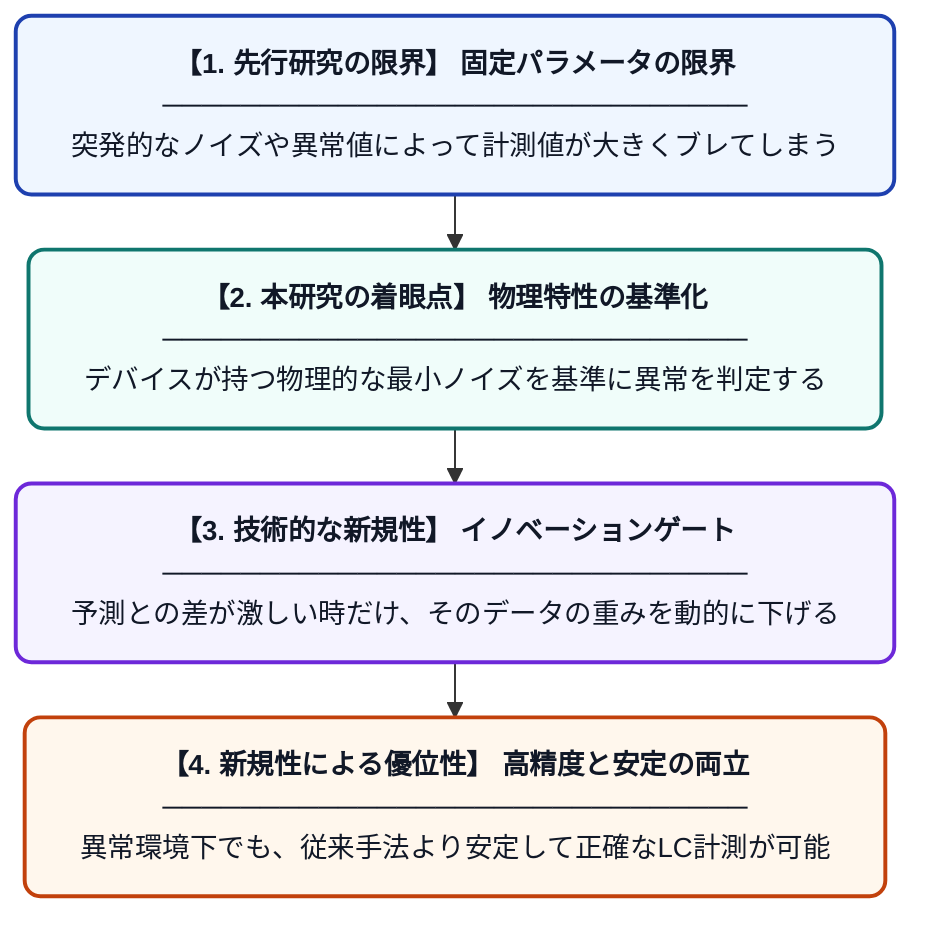

# 物理ノイズフロアに基づく組み込みLC計測用イノベーションゲート付きカルマンフィルタ

**Original Title**: *Innovation-Gated Kalman Filtering Based on a Physical Noise Floor for Embedded LC Measurement*

> **💡 一言要約**: ノイズを見極め、異常値に惑わされない高精度LC計測

| 項目 | 内容 |
|---|---|
| **著者** | S Guo, Y Yang |
| **掲載誌** | 10th International Conference on Communication … 2026 |
| **アラートキーワード** | kalman filter |
| **原文リンク** | [https://ieeexplore.ieee.org/abstract/document/11745826/](https://ieeexplore.ieee.org/abstract/document/11745826/) |
| **PDF版要約** | [README.pdf](./README.pdf) |

---

## 📊 新規性の図解（先行研究との違いと本研究のブレークスルー）

## 📝 要約

組み込みシステムにおけるLC（誘導・容量）計測の精度向上を目的に、物理的なノイズフロアを基準とした新しいカルマンフィルタを提案しています。異常な観測値が発生した際に、その「イノベーション（予測値との差）」に応じて誤差分散を動的に調整することで、高精度な計測を維持します。

## ❓ どんな問題に取り組んだか

従来のカルマンフィルタでは、突発的なノイズやセンサーの異常値が混入すると推定精度が大幅に低下する課題がありました。特に低消費電力な組み込み環境では、物理的なノイズの影響を受けやすく、安定した高精度の計測を維持することが困難でした。

## ✨ 何が新しい？何がすごい？（新規性）

本研究の最大の特徴は、物理的なノイズフロアを閾値とした「ゲート機構」をカルマンフィルタに統合した点です。観測値が予測から大きく外れた場合（イノベーションが大きい場合）のみ、該当する観測チャネルの分散を増加させることで、異常値の影響を瞬時に遮断します。これにより、正常時の追従性を損なうことなく、異常に対する堅牢性を大幅に向上させています。

## 🎓 大学1年生向けの解説

電気回路の部品（コイルやコンデンサ）の値を測るとき、周りのノイズのせいで値がフラフラしてしまうことがあります。この研究では、そのフラつきが「いつもの小さなノイズ」なのか「おかしな異常データ」なのかを自動で見分ける仕組みを作りました。変なデータが来たときだけ計算方法をサッと切り替えることで、どんな場所でも正しく値を測れるようになります。
