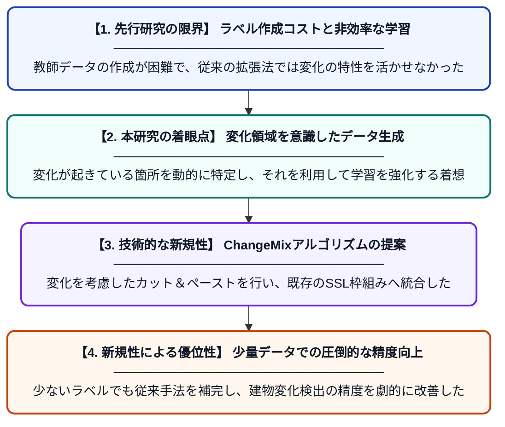

# ChangeMix：半教師ありリモートセンシング建物変化検出のための変化を考慮したカット＆ペースト拡張

**Original Title**: *ChangeMix: Change-Aware Cut-and-Paste Augmentation for Semi-Supervised Remote Sensing Building Change Detection*

> **💡 一言要約**: 変化を切り貼りして建物の変化検出を賢く強化

| 項目 | 内容 |
|---|---|
| **著者** | IM Motoi, W Huang, TA Ciarfuglia, D Nardi, XX Zhu |
| **掲載誌** | IEEE Transactions on … 2026 |
| **アラートキーワード** | Semi supervise |
| **原文リンク** | [https://ieeexplore.ieee.org/abstract/document/11775324/](https://ieeexplore.ieee.org/abstract/document/11775324/) |
| **PDF版要約** | [README.pdf](./README.pdf) |

---

## 📊 新規性の図解（先行研究との違いと本研究のブレークスルー）

## 📝 要約

リモートセンシング画像から建物の変化を検出する際、ラベルなしデータを有効活用するための新しいデータ拡張手法「ChangeMix」を提案しました。変化のある領域を動的に切り貼りして学習サンプルを生成することで、半教師あり学習の精度を大幅に向上させています。

## ❓ どんな問題に取り組んだか

リモートセンシングによる変化検出では、教師データの作成コストが極めて高いことが課題です。従来の半教師あり学習では、変化のパターンを考慮したデータ拡張が不十分で、ラベルなしデータを効率的に学習に活かせていませんでした。

## ✨ 何が新しい？何がすごい？（新規性）

本研究の核心は、変化を考慮して画像を動的に生成する「ChangeMix」を開発したことです。単なるランダムなデータ拡張とは異なり、変化領域を認識して整合性のあるサンプルを構築し、FixMatchなどの既存の学習フレームワークに組み込むことを可能にしました。これにより、限られたラベルデータでも変化検出の性能を最大化できることを示しました。

## 🎓 大学1年生向けの解説

人工衛星などで撮った写真から、新しく建物が建ったり壊されたりした場所を自動で見つけるAIの研究です。AIを賢くするには大量の「正解」が必要ですが、人間がそれを用意するのは大変なので、この研究ではAIが自分で学習用データを工夫して作り出す方法を考えました。具体的には「変化があった場所」をコピーして別の写真に貼り付けることで、少ない手本からでもAIが効率よく学習できる仕組みを作りました。
