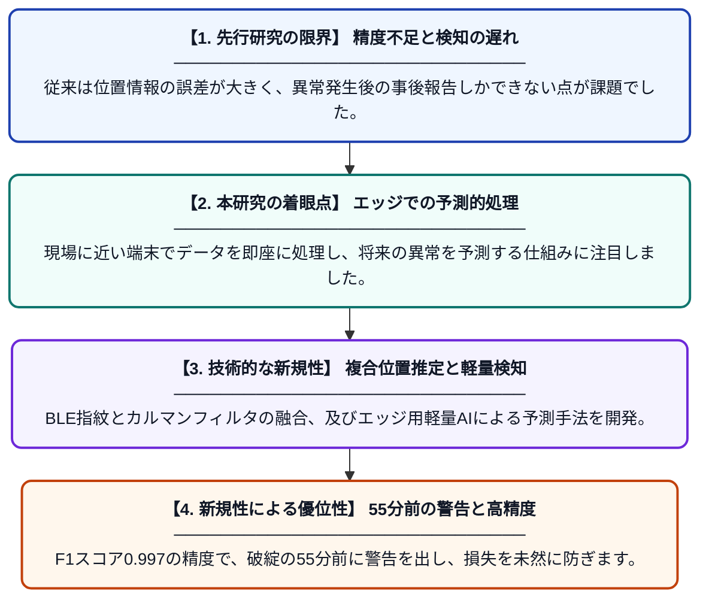

# IoTとエッジコンピューティングを活用したインテリジェントなヘルスケア物流プラットフォームの開発

**Original Title**: *Development of an Intelligent Healthcare Logistics Platform Using IoT and Edge Computing*

> **💡 一言要約**: 物流の異常を55分前に察知する医療IoT基盤

| 項目 | 内容 |
|---|---|
| **著者** | R Campbell¹, K Stewart, B Morris |
| **アラートキーワード** | kalman filter  "anomaly ... |
| **PDF** | [https://www.researchgate.net/profile/Ogunaike-Bola/publication/417867897_Development_of_an_Intelligent_Healthcare_Logistics_Platform_Using_IoT_and_Edge_Computing/links/6af782d7dc41aa6ac3117f08/Development-of-an-Intelligent-Healthcare-Logistics-Platform-Using-IoT-and-Edge-Computing.pdf](https://www.researchgate.net/profile/Ogunaike-Bola/publication/417867897_Development_of_an_Intelligent_Healthcare_Logistics_Platform_Using_IoT_and_Edge_Computing/links/6af782d7dc41aa6ac3117f08/Development-of-an-Intelligent-Healthcare-Logistics-Platform-Using-IoT-and-Edge-Computing.pdf) |
| **原文リンク** | [https://www.researchgate.net/profile/Ogunaike-Bola/publication/417867897_Development_of_an_Intelligent_Healthcare_Logistics_Platform_Using_IoT_and_Edge_Computing/links/6af782d7dc41aa6ac3117f08/Development-of-an-Intelligent-Healthcare-Logistics-Platform-Using-IoT-and-Edge-Computing.pdf](https://www.researchgate.net/profile/Ogunaike-Bola/publication/417867897_Development_of_an_Intelligent_Healthcare_Logistics_Platform_Using_IoT_and_Edge_Computing/links/6af782d7dc41aa6ac3117f08/Development-of-an-Intelligent-Healthcare-Logistics-Platform-Using-IoT-and-Edge-Computing.pdf) |
| **PDF版要約** | [README.pdf](./README.pdf) |

---

## 📊 新規性の図解（先行研究との違いと本研究のブレークスルー）

## 📝 要約

IoTとエッジコンピューティングを統合し、医療物資の配送を最適化するプラットフォームを開発しました。BLE指紋認証とカルマンフィルタを組み合わせた高精度な位置推定と、55分前に異常を知らせる軽量なコールドチェーン検知機能を備えています。

## ❓ どんな問題に取り組んだか

医療物資の輸送では厳格な温度管理とリアルタイムの位置把握が不可欠ですが、従来のシステムは精度不足や通信遅延が課題でした。特に、異常が発生した後にしか対応できないことが多く、高価な薬品の廃棄リスクを減らすための早期警告システムが求められていました。

## ✨ 何が新しい？何がすごい？（新規性）

BLE指紋認証にカルマンフィルタを融合させた独自のエッジ位置推定手法を開発し、追跡精度を大幅に向上させました。また、エッジデバイス上で動作する軽量な異常検知アルゴリズムを導入することで、クラウドに依存せず55分前に異常を予測することに成功しました。このシステムはF1スコア0.997という極めて高い精度を誇り、リアルタイム性と信頼性を両立しています。

## 🎓 大学1年生向けの解説

病院で使うお薬や血液は、適切な温度で運ばないと使い物にならなくなってしまいます。この研究では、荷物に付けた小さなコンピューターが自ら状況を判断し、「あと55分で温度が危険になる！」と事前に教えてくれる魔法のようなシステムを作りました。建物のどこにあるかも正確にわかるので、問題が起きる前に対処できます。これにより、大事な医療物資を守り、安全に患者さんに届けられるようになります。
