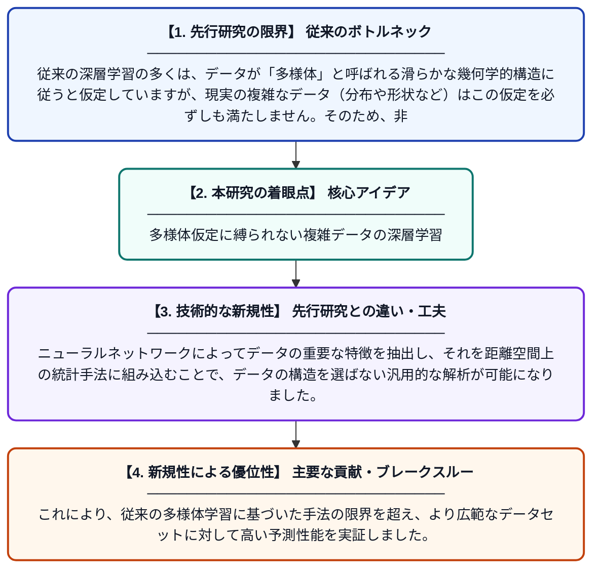

# 距離空間におけるランダム・オブジェクトのためのディープラーニング：多様体仮定を超えて

**Original Title**: *Deep Learning for Random Objects in Metric Spaces: Beyond Manifold Assumptions*

> **💡 一言要約**: 多様体仮定に縛られない複雑データの深層学習

| 項目 | 内容 |
|---|---|
| **著者** | M Matabuena, X Luo, OHM Padilla |
| **掲載誌** | arXiv preprint arXiv:2610.31328 2026 |
| **アラートキーワード** | manifold learning |
| **PDF** | [https://arxiv.org/pdf/2610.31328](https://arxiv.org/pdf/2610.31328) |
| **原文リンク** | [https://arxiv.org/pdf/2610.31328](https://arxiv.org/pdf/2610.31328) |
| **PDF版要約** | [README.pdf](./README.pdf) |

---

## 📊 新規性の図解（先行研究との違いと本研究のブレークスルー）

## 📝 要約

確率分布やグラフなどの複雑なデータ（ランダム・オブジェクト）をディープラーニングで解析するための新しい枠組みを提案した論文です。データが特定の滑らかな構造（多様体）に従うという従来の強い仮定を排除し、低次元表現学習とフレシェ回帰を組み合わせることで、より柔軟な予測モデルを実現しました。

## ❓ どんな問題に取り組んだか

従来の深層学習の多くは、データが「多様体」と呼ばれる滑らかな幾何学的構造に従うと仮定していますが、現実の複雑なデータ（分布や形状など）はこの仮定を必ずしも満たしません。そのため、非ユークリッド的な距離空間に存在するデータを、理論的な保証を持ちつつ精度良く扱う手法が求められていました。

## ✨ 何が新しい？何がすごい？（新規性）

本研究の最大の特徴は、多様体学習とディープリグレッションを「フレシェ回帰」という統計的枠組みで統合した点にあります。ニューラルネットワークによってデータの重要な特徴を抽出し、それを距離空間上の統計手法に組み込むことで、データの構造を選ばない汎用的な解析が可能になりました。これにより、従来の多様体学習に基づいた手法の限界を超え、より広範なデータセットに対して高い予測性能を実証しました。

## 🎓 大学1年生向けの解説

AIの世界では通常、データは「平らな地図」の上に整理できると考えられてきましたが、現実には地図に描けないような「いびつな形」をしたデータ（ネットワークや確率の塊など）がたくさんあります。この研究は、そうした複雑なデータを「距離」という柔軟なルールだけで捉える新しいAIの計算方法を開発しました。これにより、今までAIが苦手としていた「特殊な形をしたデータ」の分析が、より正確に行えるようになります。
