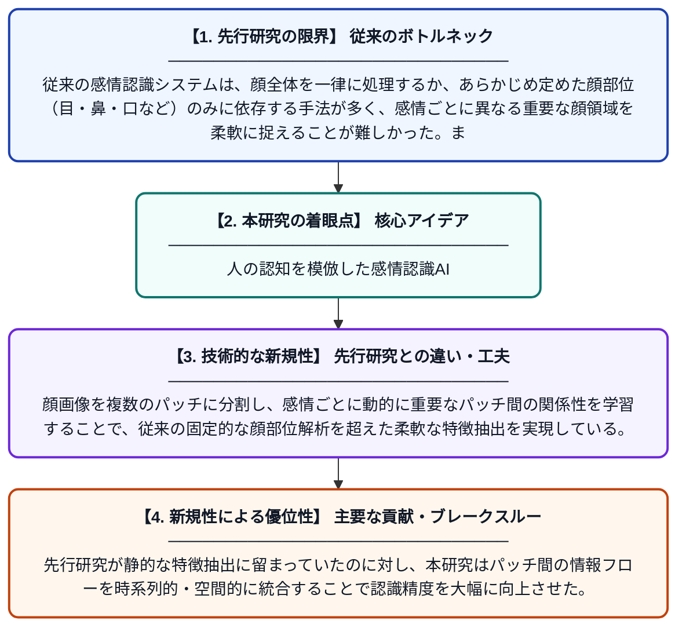

# 見て感じる：マルチパッチベースのアテンションフローによる認知インスパイア型感情認識

**Original Title**: *Feel with Seeing: Cognition-Inspired Emotion Recognition via Multi-patch-based Attention Flow*

> **💡 一言要約**: 人の認知を模倣した感情認識AI

| 項目 | 内容 |
|---|---|
| **著者** | Z Lin, J Liu, K Guo, J Luo, Y Qin, M Chen, X Wu |
| **掲載誌** | IEEE Transactions on Affective Computing 2026 |
| **アラートキーワード** | affective computing |
| **原文リンク** | [https://ieeexplore.ieee.org/abstract/document/11618920/](https://ieeexplore.ieee.org/abstract/document/11618920/) |
| **PDF版要約** | [README.pdf](./README.pdf) |

---

## 📊 新規性の図解（先行研究との違いと本研究のブレークスルー）

## 📝 要約

本論文は、人間の認知プロセスにヒントを得た新しい感情認識手法を提案している。顔画像を複数の小領域（パッチ）に分割し、アテンションフロー機構を用いて感情に関連する重要な部位を動的に捉えることで、高精度な感情認識を実現する。人間が他者の表情を読み取る際の視線や注意の流れを模倣することで、より自然で頑健な感情認識を目指している。

## ❓ どんな問題に取り組んだか

従来の感情認識システムは、顔全体を一律に処理するか、あらかじめ定めた顔部位（目・鼻・口など）のみに依存する手法が多く、感情ごとに異なる重要な顔領域を柔軟に捉えることが難しかった。また、人間が表情を読み取る際に行う動的な注意の移動を再現できていないという課題があった。

## ✨ 何が新しい？何がすごい？（新規性）

本研究は、人間の認知メカニズム（視点移動・選択的注意）をモデル化したマルチパッチベースのアテンションフロー機構を新たに導入した点が独自性の核心である。顔画像を複数のパッチに分割し、感情ごとに動的に重要なパッチ間の関係性を学習することで、従来の固定的な顔部位解析を超えた柔軟な特徴抽出を実現している。先行研究が静的な特徴抽出に留まっていたのに対し、本研究はパッチ間の情報フローを時系列的・空間的に統合することで認識精度を大幅に向上させた。

## 🎓 大学1年生向けの解説

人はほかの人の顔を見るとき、目や口など顔のいろいろな部分に順番に注目しながら「この人は怒っているかな？悲しいのかな？」と感情を読み取っています。この研究では、AIにも同じことをさせるため、顔画像を小さなブロック（パッチ）に分けて、どのブロックに注目すべきかをAI自身が自動的に学ぶ仕組みを作りました。これにより、AIが人間のように「見ながら感じる」感情認識を実現しており、様々な表情をより正確に判別できるようになっています。
