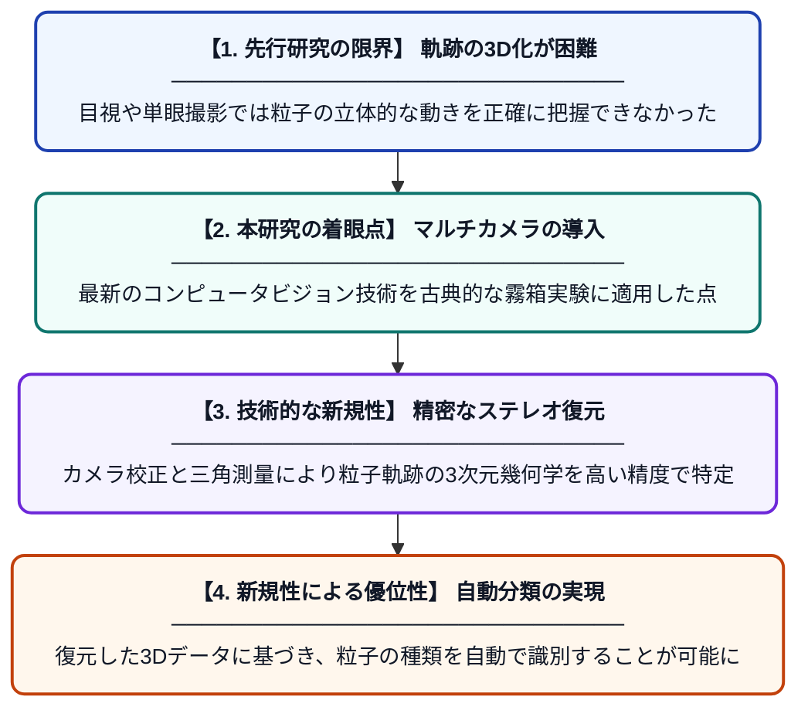

# 拡散霧箱における電離粒子軌跡のステレオ復元と分類

**Original Title**: *Stereo Reconstruction and Classification of Ionizing Particle Tracks in a Diffusion Cloud Chamber*

> **💡 一言要約**: 霧箱の粒子軌跡を3Dで精密に再現し自動分類する

| 項目 | 内容 |
|---|---|
| **著者** | A Simonson |
| **アラートキーワード** | Multi Camera Tracking |
| **PDF** | [https://git.asimonson.com/andrew/asimonson1125.github.io/raw/commit/15c1f4120491e277417a2c2a06c6e2afc36081c0/src/static/papers/capstone-proposal.pdf](https://git.asimonson.com/andrew/asimonson1125.github.io/raw/commit/15c1f4120491e277417a2c2a06c6e2afc36081c0/src/static/papers/capstone-proposal.pdf) |
| **原文リンク** | [https://git.asimonson.com/andrew/asimonson1125.github.io/raw/commit/15c1f4120491e277417a2c2a06c6e2afc36081c0/src/static/papers/capstone-proposal.pdf](https://git.asimonson.com/andrew/asimonson1125.github.io/raw/commit/15c1f4120491e277417a2c2a06c6e2afc36081c0/src/static/papers/capstone-proposal.pdf) |
| **PDF版要約** | [README.pdf](./README.pdf) |

---

## 📊 新規性の図解（先行研究との違いと本研究のブレークスルー）

## 📝 要約

霧箱内で発生する放射線の軌跡を複数のカメラで撮影し、ステレオ三角測量を用いて3次元的な形状を精密に復元する手法を提案しています。標準的なカメラ校正技術を応用することで、歴史的な観測装置である霧箱における粒子軌跡の自動分類と高精度な解析を可能にしました。

## ❓ どんな問題に取り組んだか

霧箱内の放射線軌跡は物理学的に重要ですが、その3次元的な幾何学形状を正確にデジタルデータとして取得することは困難でした。従来の観測手法では客観的な数値化や大規模な自動解析を行うための技術的基盤が不足していました。

## ✨ 何が新しい？何がすごい？（新規性）

本研究は、20世紀中盤から続く霧箱観測の概念に、現代的なコンピュータビジョンのステレオ復元技術を統合した点が画期的です。標準的なカメラ校正とマルチカメラによる三角測量を組み合わせることで、粒子の真の3次元走行軌跡を特定し、その特徴から粒子の種類を分類することに成功しました。これは、古典的な物理実験と最新のデジタル画像解析を橋渡しする重要な貢献です。

## 🎓 大学1年生向けの解説

霧箱は、目に見えない放射線が通った跡を「飛行機雲」のような白い筋として見せる装置です。この研究では、複数のカメラを使ってその筋を立体的に捉え、コンピュータ上で3Dモデルとして再現する技術を開発しました。これにより、その粒子がどの方向に、どのような力で飛んだのかを自動で正確に判定できるようになります。昔からある実験装置に最新のカメラ技術を組み合わせた、非常に面白い研究です。
