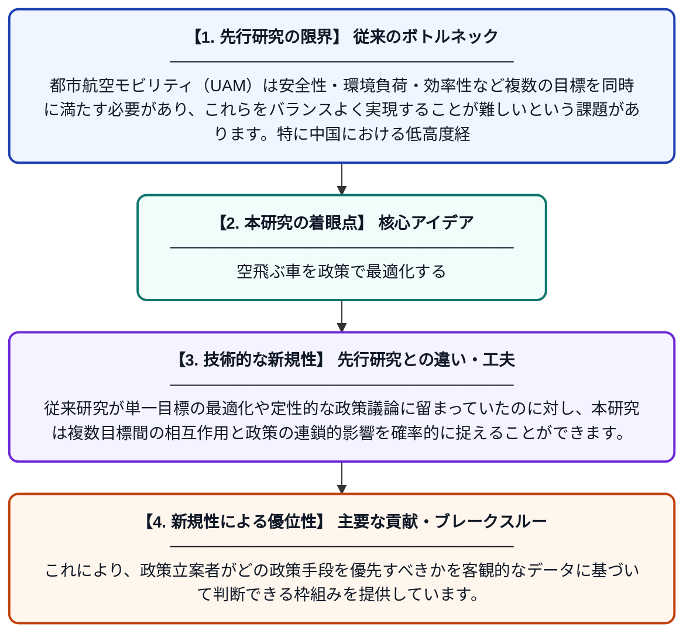

# 都市航空モビリティの多目標に対する政策効果：PSR-ベイジアンネットワークモデルに基づく分析

**Original Title**: *Policy effects on multi-objective of Urban Air Mobility: Based on the PSR-Bayesian network model*

> **💡 一言要約**: 空飛ぶ車を政策で最適化する

| 項目 | 内容 |
|---|---|
| **著者** | REN Xinhui, Y JIANG |
| **掲載誌** | Transport Policy 2026 |
| **アラートキーワード** | bayesian network |
| **原文リンク** | [https://www.sciencedirect.com/science/article/pii/S0967070X26003343](https://www.sciencedirect.com/science/article/pii/S0967070X26003343) |
| **PDF版要約** | [README.pdf](./README.pdf) |

---

## 📊 新規性の図解（先行研究との違いと本研究のブレークスルー）

## 📝 要約

本研究は、中国の戦略的新興産業である低高度経済の中核を担う都市航空モビリティ（UAM）において、政策が複数の目標（安全性・効率性・環境性など）の協調的発展にどう影響するかを分析したものです。PSR（プレッシャー・状態・レスポンス）フレームワークとベイジアンネットワークを組み合わせたモデルを構築し、政策介入の効果を定量的に評価しています。得られた知見は、UAMの高品質な多目標開発を推進するための政策立案に実践的な示唆を与えます。

## ❓ どんな問題に取り組んだか

都市航空モビリティ（UAM）は安全性・環境負荷・効率性など複数の目標を同時に満たす必要があり、これらをバランスよく実現することが難しいという課題があります。特に中国における低高度経済の急速な発展に伴い、どのような政策がUAMの多目標達成に有効かを科学的に評価する手法が不足していました。

## ✨ 何が新しい？何がすごい？（新規性）

本研究は、環境分析で用いられるPSR（プレッシャー・状態・レスポンス）フレームワークをUAM政策評価に初めて応用し、ベイジアンネットワークと統合することで不確実性を考慮した定量的な政策効果分析を実現しました。従来研究が単一目標の最適化や定性的な政策議論に留まっていたのに対し、本研究は複数目標間の相互作用と政策の連鎖的影響を確率的に捉えることができます。これにより、政策立案者がどの政策手段を優先すべきかを客観的なデータに基づいて判断できる枠組みを提供しています。

## 🎓 大学1年生向けの解説

「空飛ぶタクシー」のような次世代の乗り物（UAM）を普及させるには、安全・環境にやさしい・便利という複数の条件を同時にクリアする必要があります。この研究では、政府の政策がこれらの条件にどう影響するかをコンピューターモデルで分析しました。「プレッシャー・状態・レスポンス」という環境問題でよく使われる考え方と、確率を使って複雑な関係を計算する「ベイジアンネットワーク」という手法を組み合わせています。これにより、どんな政策を打てばUAMがうまく発展するかを科学的に示すことができます。将来の空の交通をより良くするための「政策の取扱説明書」を作るようなイメージです。
