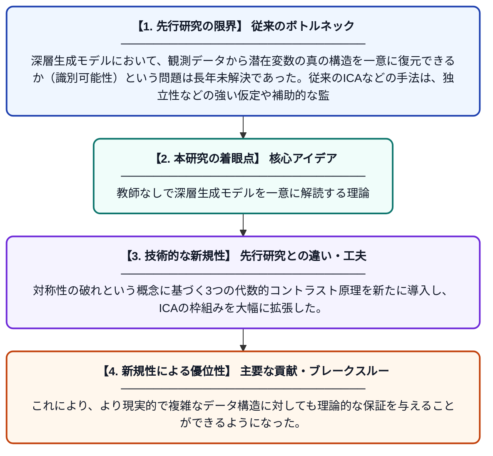

# ICAを超えて：対称性の破れによる識別可能性

**Original Title**: *Beyond ICA: Identifiability by Symmetry Breaking*

> **💡 一言要約**: 教師なしで深層生成モデルを一意に解読する理論

| 項目 | 内容 |
|---|---|
| **著者** | P Wu |
| **掲載誌** | arXiv preprint arXiv:2607.23182 2026 |
| **アラートキーワード** | ICA |
| **PDF** | [https://arxiv.org/pdf/2607.23182](https://arxiv.org/pdf/2607.23182) |
| **原文リンク** | [https://arxiv.org/pdf/2607.23182](https://arxiv.org/pdf/2607.23182) |
| **PDF版要約** | [README.pdf](./README.pdf) |

---

## 📊 新規性の図解（先行研究との違いと本研究のブレークスルー）

## 📝 要約

本論文は、区分的アフィン（PWA）デコーダとガウス混合モデル（GMM）事前分布を持つ深層生成モデル（DGM）の識別可能性を、完全に教師なしの設定で数学的に証明する。対称性の破れのための3つの代数的コントラスト原理を新たに導入し、独立成分分析（ICA）の限界を超える新しい枠組みを提案する。これにより、従来は補助情報や強い仮定が必要だった潜在変数モデルの識別可能性を、より一般的な条件で保証することが可能となった。

## ❓ どんな問題に取り組んだか

深層生成モデルにおいて、観測データから潜在変数の真の構造を一意に復元できるか（識別可能性）という問題は長年未解決であった。従来のICAなどの手法は、独立性などの強い仮定や補助的な監督信号を必要とし、完全教師なし設定での一般的な識別可能性の保証が困難であった。

## ✨ 何が新しい？何がすごい？（新規性）

先行研究ではラベルや補助変数を必要とするケースが多かったが、本研究は純粋に教師なしの設定でPWAデコーダとGMM事前分布という組み合わせに対して厳密な識別可能性を証明した点が革新的である。対称性の破れという概念に基づく3つの代数的コントラスト原理を新たに導入し、ICAの枠組みを大幅に拡張した。これにより、より現実的で複雑なデータ構造に対しても理論的な保証を与えることができるようになった。

## 🎓 大学1年生向けの解説

AIがデータを生成する仕組み（深層生成モデル）には、データの背後にある隠れた要因（潜在変数）を学習するという目標があります。しかし、同じデータを生成できる隠れた要因の組み合わせは無数にあり得るため、「本当の答えを一つに絞れるか」という問題があります。この論文は、特定の数学的な構造を持つモデルであれば、ヒントなし（教師なし）でも答えを一意に特定できることを数学的に証明しました。これは「対称性の破れ」というアイデアを使って実現されており、暗号を解読するための数学的な鍵を見つけたようなイメージです。
