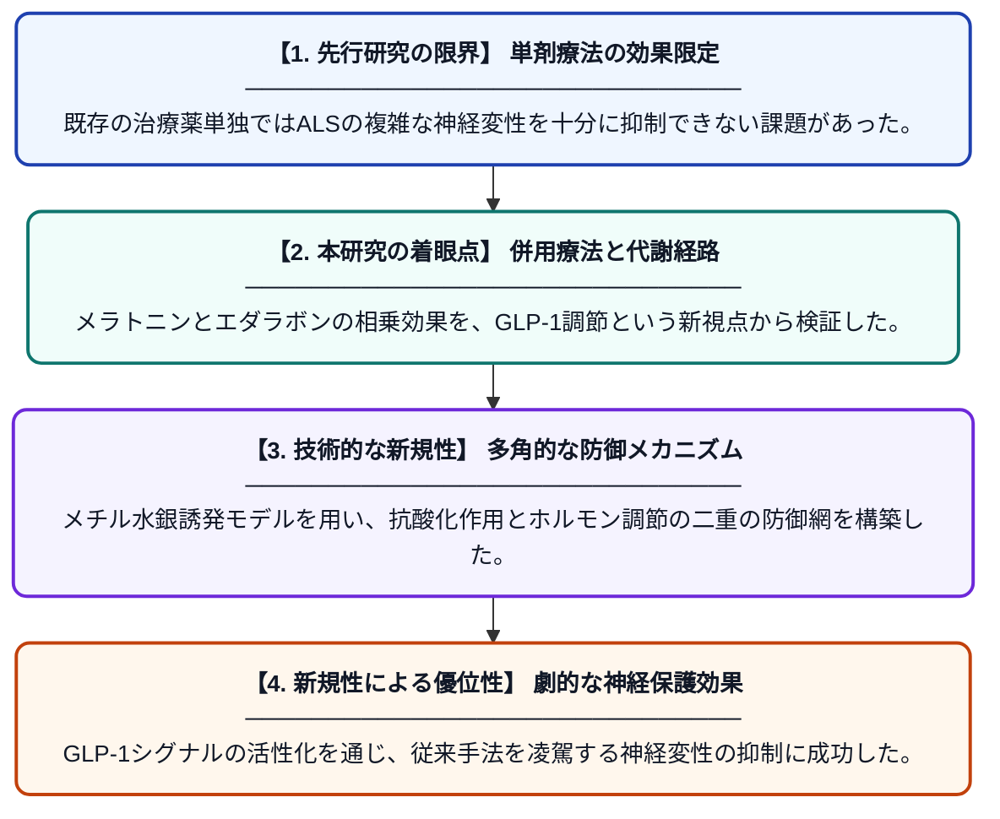

# メラトニンとエダラボンの併用療法は、GLP-1調節を介してメチル水銀誘発性筋萎縮性側索硬化症（ALS）様神経変性を緩和する

**Original Title**: *Combined melatonin and edaravone therapy attenuates methylmercury-induced amyotrophic lateral sclerosis-like neurodegeneration through GLP-1 modulation and …*

> **💡 一言要約**: メラトニンとエダラボンの併用でALSに挑む

| 項目 | 内容 |
|---|---|
| **著者** | GS Raina, S Mehan, G Das Gupta |
| **掲載誌** | Naunyn-Schmiedeberg's Archives of … 2026 |
| **アラートキーワード** | ALS |
| **原文リンク** | [https://link.springer.com/article/10.1007/s00210-026-06009-x](https://link.springer.com/article/10.1007/s00210-026-06009-x) |
| **PDF版要約** | [README.pdf](./README.pdf) |

---

## 📊 新規性の図解（先行研究との違いと本研究のブレークスルー）

## 📝 要約

本研究は、難病であるALSの病態解明と治療法開発のため、メチル水銀で誘発したALSモデルを用い、メラトニンとエダラボンの併用効果を検証しました。その結果、これら二つの薬剤の組み合わせが、GLP-1受容体を介した経路を調節することで、神経変性を効果的に抑制することを明らかにしました。

## ❓ どんな問題に取り組んだか

筋萎縮性側索硬化症（ALS）は進行性の致死的な神経変性疾患ですが、その発症メカニズムは未だ十分に解明されておらず、効果的な治療法も限られています。特に、環境毒素であるメチル水銀がどのようにALS様の神経損傷を引き起こし、それをどう防ぐかが重要な課題となっています。

## ✨ 何が新しい？何がすごい？（新規性）

本研究の最大の特徴は、抗酸化作用を持つメラトニンと既存のALS治療薬エダラボンを組み合わせ、その相乗効果をGLP-1シグナル伝達の観点から解明した点にあります。単剤投与よりも高い神経保護効果を示すことを確認し、GLP-1経路がALS治療の新たな標的として有効であることを実験的に証明しました。これにより、環境要因による神経毒性に対する多角的な防御戦略を提示しています。

## 🎓 大学1年生向けの解説

ALSは全身の筋肉が徐々に動かなくなる病気ですが、その詳しい原因はわかっていません。この研究では、水銀の毒で再現したALSの状態に対して、眠りのホルモンとして知られる「メラトニン」と、すでに薬として使われている「エダラボン」を一緒に使ってみました。すると、それぞれを単独で使うよりも効果的に神経を守れることがわかりました。この効果には、血糖値の調節などに関わる「GLP-1」という物質の働きが重要であることも突き止めました。
