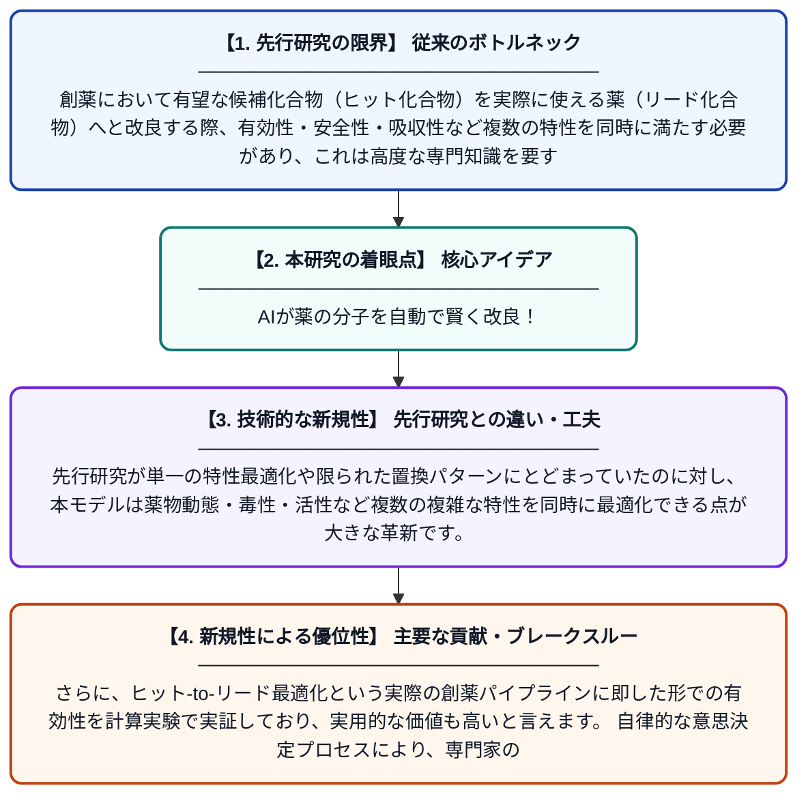

# 創薬における多目的最適化のための自律的なバイオアイソステリック置換

**Original Title**: *Autonomous bioisosteric replacement for multi-property optimization in drug design*

> **💡 一言要約**: AIが薬の分子を自動で賢く改良！

| 項目 | 内容 |
|---|---|
| **著者** | H Kim, S Moon, W Zhung, S Kim, J Lim, WY Kim |
| **掲載誌** | Nature Communications 2026 |
| **アラートキーワード** | optimization |
| **PDF** | [https://www.nature.com/articles/s41467-026-75512-9_reference.pdf](https://www.nature.com/articles/s41467-026-75512-9_reference.pdf) |
| **Git リポジトリ** | [https://github.com/Hwoo-Kim/DeepBioisostere](https://github.com/Hwoo-Kim/DeepBioisostere) |
| **原文リンク** | [https://www.nature.com/articles/s41467-026-75512-9_reference.pdf](https://www.nature.com/articles/s41467-026-75512-9_reference.pdf) |
| **PDF版要約** | [README.pdf](./README.pdf) |

---

## 📊 新規性の図解（先行研究との違いと本研究のブレークスルー）

## 📝 要約

本研究では、創薬プロセスにおける「バイオアイソステリック置換」を自律的に行うAIモデルを開発しました。分子グラフ全体にわたって複数の薬物特性を同時に最適化できるこのモデルは、ヒット化合物からリード化合物への最適化プロセスで高い有効性を示しました。計算化学的なアプローチにより、従来は専門家の経験に頼っていた多目的な分子設計を自動化することに成功しています。

## ❓ どんな問題に取り組んだか

創薬において有望な候補化合物（ヒット化合物）を実際に使える薬（リード化合物）へと改良する際、有効性・安全性・吸収性など複数の特性を同時に満たす必要があり、これは高度な専門知識を要する複雑な作業です。特に「バイオアイソステリック置換」と呼ばれる分子の一部を似た性質の別の構造に置き換える手法は、経験豊富な化学者でも難しい判断を伴います。従来の計算手法では、複数の特性を同時に最適化することが難しく、自動化も困難でした。

## ✨ 何が新しい？何がすごい？（新規性）

本研究は、分子グラフ構造全体を考慮しながらバイオアイソステリック置換を自律的に実行できる初めての包括的なAIモデルを提案しています。先行研究が単一の特性最適化や限られた置換パターンにとどまっていたのに対し、本モデルは薬物動態・毒性・活性など複数の複雑な特性を同時に最適化できる点が大きな革新です。さらに、ヒット-to-リード最適化という実際の創薬パイプラインに即した形での有効性を計算実験で実証しており、実用的な価値も高いと言えます。自律的な意思決定プロセスにより、専門家の介入なしに最適な置換を選択できる点も先行研究との重要な差別化点です。

## 🎓 大学1年生向けの解説

薬を作るとき、最初に見つかった候補の分子をより良い薬になるよう「改良」する作業が必要です。この改良では、効き目が強くて副作用が少なく、体に吸収されやすいなど、たくさんの条件を同時にクリアしなければなりません。この研究では、AIが分子の一部を似た性質の別の部品に自動で取り替えながら、これらの条件を同時に満たす最適な分子を探し出す方法を開発しました。これはまるで、料理のレシピを見ながら食材を賢く代替品に置き換えて、栄養・味・コストを同時に改善するようなイメージです。このAIによって、従来は熟練した化学者が長い時間をかけて行っていた作業を、コンピューターが自動で効率よく行えるようになります。
