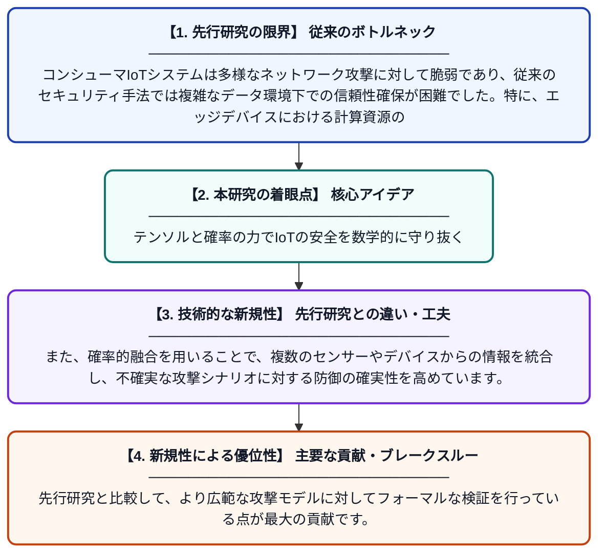

# 信頼性と安全性の高いコンシューマIoTシステムのためのテンソル強化型変分正則化と確率的融合

**Original Title**: *Tensor-Empowered Variational Regularization and Probabilistic Fusion for Reliable and Secure Consumer IoT Systems*

> **💡 一言要約**: テンソルと確率の力でIoTの安全を数学的に守り抜く

| 項目 | 内容 |
|---|---|
| **著者** | D Xin, LT Yang, J Yang, Y Gao |
| **掲載誌** | IEEE Transactions on Consumer Electronics 2026 |
| **アラートキーワード** | Secure Computing |
| **原文リンク** | [https://ieeexplore.ieee.org/abstract/document/11749654/](https://ieeexplore.ieee.org/abstract/document/11749654/) |
| **PDF版要約** | [README.pdf](./README.pdf) |

---

## 📊 新規性の図解（先行研究との違いと本研究のブレークスルー）

## 📝 要約

コンシューマ向けIoTデバイスのセキュリティ脅威に対処するため、テンソル計算を用いた変分正則化と確率的融合を組み合わせた新手法を提案しています。攻撃モデルを定式化することで、多様なサイバー攻撃に対するシステムの耐性を数学的に分析し、信頼性の高いエッジインテリジェンスを実現しています。

## ❓ どんな問題に取り組んだか

コンシューマIoTシステムは多様なネットワーク攻撃に対して脆弱であり、従来のセキュリティ手法では複雑なデータ環境下での信頼性確保が困難でした。特に、エッジデバイスにおける計算資源の制約と、高度化する攻撃へのリアルタイムな対応を両立させる必要がありました。

## ✨ 何が新しい？何がすごい？（新規性）

多次元データを効率的に扱うテンソル強化型変分正則化を導入し、ノイズの多い環境下でも精密なデータ復元と異常検知を可能にしました。また、確率的融合を用いることで、複数のセンサーやデバイスからの情報を統合し、不確実な攻撃シナリオに対する防御の確実性を高めています。先行研究と比較して、より広範な攻撃モデルに対してフォーマルな検証を行っている点が最大の貢献です。

## 🎓 大学1年生向けの解説

家の中にあるスマート家電などのIoT機器は、常にインターネットを通じた攻撃の危険にさらされています。この研究では、データを「テンソル」という立体的な数学の塊として捉えることで、情報の不備や攻撃による改ざんを素早く見つける魔法のようなフィルターを作りました。これにより、どんなに複雑な攻撃が来ても、システムが自分で判断して安全を守り続けることができるようになります。大学で学ぶ数学が、私たちのプライバシーを直接守る技術に役立っている例です。
