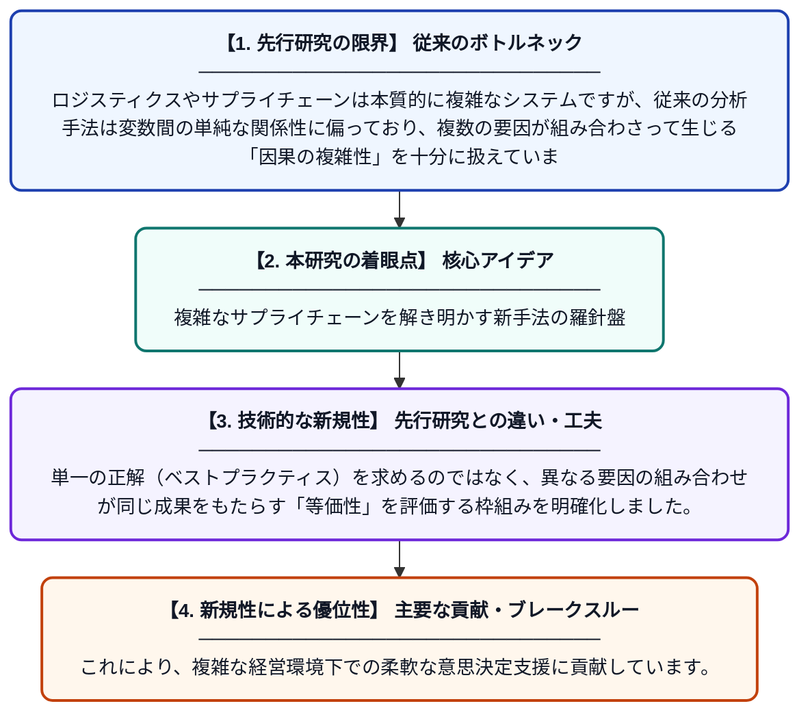

# ロジスティクスおよびサプライチェーンマネジメントにおけるfsQCAの応用：系統的レビュー

**Original Title**: *Applications of fsQCA in Logistics and Supply Chain Management: A Systematic Review*

> **💡 一言要約**: 複雑なサプライチェーンを解き明かす新手法の羅針盤

| 項目 | 内容 |
|---|---|
| **著者** | P Chowdhury, MT Islam, EA Khan, MMH Chowdhury… |
| **掲載誌** | Global Journal of Flexible … 2026 |
| **アラートキーワード** | logistics |
| **原文リンク** | [https://link.springer.com/article/10.1007/s40171-026-00512-z](https://link.springer.com/article/10.1007/s40171-026-00512-z) |
| **PDF版要約** | [README.pdf](./README.pdf) |

---

## 📊 新規性の図解（先行研究との違いと本研究のブレークスルー）

## 📝 要約

サプライチェーン管理（LSCM）における因果関係の複雑さを解明するため、質的比較分析（fsQCA）の適用事例を網羅的に調査したレビュー論文です。従来の統計手法では捉えきれなかった、複数の要因が絡み合うシステム的な相互作用を分析する手法としての有効性を提示しています。

## ❓ どんな問題に取り組んだか

ロジスティクスやサプライチェーンは本質的に複雑なシステムですが、従来の分析手法は変数間の単純な関係性に偏っており、複数の要因が組み合わさって生じる「因果の複雑性」を十分に扱えていませんでした。そのため、実務における多様な成功パターンの特定が難しいという課題がありました。

## ✨ 何が新しい？何がすごい？（新規性）

本研究は、LSCM分野におけるfsQCAの活用状況を初めて体系的に整理し、システム思考に基づいた分析の有用性を実証した点に新規性があります。単一の正解（ベストプラクティス）を求めるのではなく、異なる要因の組み合わせが同じ成果をもたらす「等価性」を評価する枠組みを明確化しました。これにより、複雑な経営環境下での柔軟な意思決定支援に貢献しています。

## 🎓 大学1年生向けの解説

モノの流れを管理する世界では、成功の理由は一つではなく、色々な条件がパズルのように組み合わさっています。この論文は、「Aがあれば成功する」という単純な考え方ではなく、「AとBのセット、あるいはCとDのセットでも成功する」という複雑な仕組みを分析する新しい道具（fsQCA）の使い方をまとめたものです。これを使うと、複雑な世の中の出来事をより正確に理解できるようになります。
