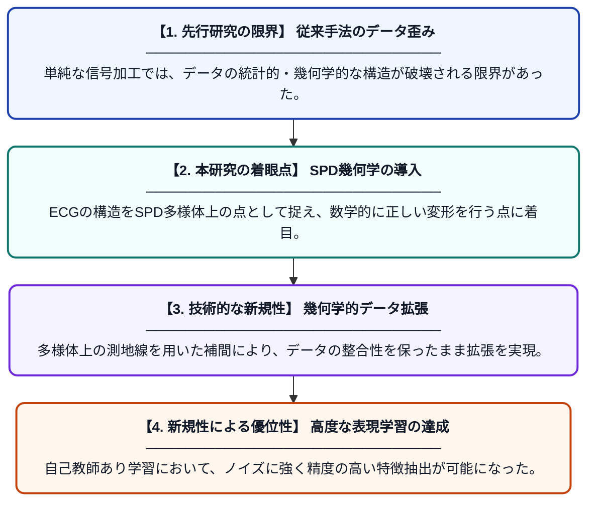

# 自己教師ありECG表現学習のためのSPD幾何学による多様体制約付きデータ拡張

**Original Title**: *Manifold-Constrained Data Augmentation via SPD Geometry for Self-Supervised ECG Representation Learning*

> **💡 一言要約**: SPD幾何学でECG解析を高度化するデータ拡張

| 項目 | 内容 |
|---|---|
| **著者** | P Gottimukkala, RR Romano |
| **掲載誌** | Journal of Advanced Intelligent Computing and … 2026 |
| **アラートキーワード** | manifold learning |
| **PDF** | [https://wrunion.org/jaici/article/download/19/15](https://wrunion.org/jaici/article/download/19/15) |
| **原文リンク** | [https://wrunion.org/jaici/article/download/19/15](https://wrunion.org/jaici/article/download/19/15) |
| **PDF版要約** | [README.pdf](./README.pdf) |

---

## 📊 新規性の図解（先行研究との違いと本研究のブレークスルー）

## 📝 要約

心電図（ECG）信号の解析において、データの統計的な構造を維持したまま学習データを増やす新しい手法を提案しています。SPD（対称正定値）行列の幾何学的な特性を利用することで、従来の単純な手法よりも効果的な自己教師あり学習を実現しました。

## ❓ どんな問題に取り組んだか

心電図のような多変量時系列データでは、ノイズ追加などの単純なデータ拡張を行うと、信号が持つ重要な幾何学的・統計的特性が壊れてしまう課題がありました。そのため、ラベルのない膨大なデータから効率的に特徴を学び取ることが困難でした。

## ✨ 何が新しい？何がすごい？（新規性）

データの分散共分散構造を「SPD多様体」上の点として扱い、その幾何学的性質に基づいたデータ拡張を導入した点が画期的です。測地的補間などの手法を用いることで、データの物理的な整合性を保ったまま多様なバリエーションを生成することを可能にしました。これにより、自己教師あり学習における表現の汎用性と精度が大幅に向上しています。

## 🎓 大学1年生向けの解説

病院で測る心電図のデータをAIに学習させる際、データの量を「水増し」して学習効率を上げることがよくあります。しかし、適当にデータをいじると、心臓の動きとしてあり得ないデータになってしまうのが悩みでした。この研究では、数学的な「曲がった空間（多様体）」のルールを使い、心電図のルールを守ったまま賢くデータを増やす方法を開発しました。これにより、少ないラベル付きデータでもAIが心臓の状態を正確に見抜けるようになります。
