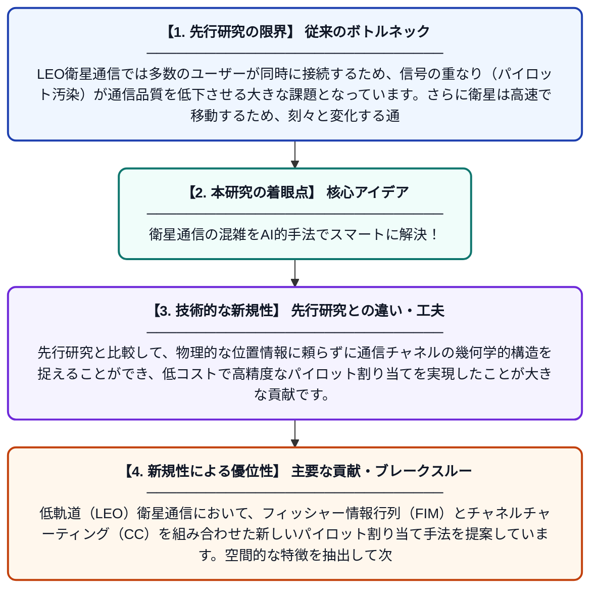

# Massive MIMO LEO 衛星通信における FIMCC 支援型パイロット割り当て

**Original Title**: *FIMCC-Aided Pilot Assignment for Massive MIMO LEO Satellite Communications*

> **💡 一言要約**: 衛星通信の混雑をAI的手法でスマートに解決！

| 項目 | 内容 |
|---|---|
| **著者** | Y Wang, L You, H Zhou, W Wang, KX Li, XG Xia, X Gao |
| **掲載誌** | IEEE Transactions on … 2026 |
| **アラートキーワード** | manifold learning |
| **原文リンク** | [https://ieeexplore.ieee.org/abstract/document/11744431/](https://ieeexplore.ieee.org/abstract/document/11744431/) |
| **PDF版要約** | [README.pdf](./README.pdf) |

---

## 📊 新規性の図解（先行研究との違いと本研究のブレークスルー）

## 📝 要約

低軌道（LEO）衛星通信において、フィッシャー情報行列（FIM）とチャネルチャーティング（CC）を組み合わせた新しいパイロット割り当て手法を提案しています。空間的な特徴を抽出して次元削減を行うことで、計算負荷を抑えつつ通信干渉を効果的に抑制する仕組みを構築しました。

## ❓ どんな問題に取り組んだか

LEO衛星通信では多数のユーザーが同時に接続するため、信号の重なり（パイロット汚染）が通信品質を低下させる大きな課題となっています。さらに衛星は高速で移動するため、刻々と変化する通信環境に対して、従来の複雑な計算手法では処理が追いつかないという問題がありました。

## ✨ 何が新しい？何がすごい？（新規性）

フィッシャー情報を含む空間特徴行列を構築し、多様体学習を用いて次元削減を行う「FIMCC」という枠組みを提案した点が独創的です。先行研究と比較して、物理的な位置情報に頼らずに通信チャネルの幾何学的構造を捉えることができ、低コストで高精度なパイロット割り当てを実現したことが大きな貢献です。

## 🎓 大学1年生向けの解説

宇宙にある衛星とスマホが通信する際、大勢が同時に使うと電波が混ざって通信が遅くなってしまいます。この研究は、電波の届き方の「特徴」を数学的に整理して、誰がどの通信用番号を使うかを効率よく割り当てる方法を開発しました。これにより、高速で移動する衛星を使っても、たくさんの人が快適にインターネットを使えるようになります。
