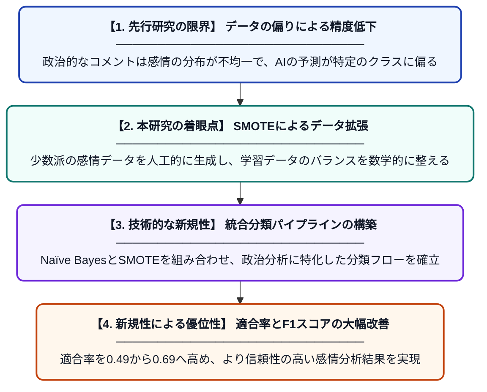

# Naïve BayesとSMOTEを用いたYouTubeにおける政治的コメントの感情分析

**Original Title**: *Sentiment Analysis of Political Comments on YouTube Using Naïve Bayes and SMOTE*

> **💡 一言要約**: 不均衡データをSMOTEで克服し政治分析の精度を向上

| 項目 | 内容 |
|---|---|
| **著者** | JM Aldianto, Y Purnama |
| **掲載誌** | Understanding Digital Culture Through the Cultural … 2027 |
| **アラートキーワード** | SMOTE |
| **原文リンク** | [https://www.igi-global.com/chapter/sentiment-analysis-of-political-comments-on-youtube-using-nave-bayes-and-smote/429089](https://www.igi-global.com/chapter/sentiment-analysis-of-political-comments-on-youtube-using-nave-bayes-and-smote/429089) |
| **PDF版要約** | [README.pdf](./README.pdf) |

---

## 📊 新規性の図解（先行研究との違いと本研究のブレークスルー）

## 📝 要約

YouTubeの政治関連コメントを対象に、機械学習アルゴリズムのNaïve Bayesとデータ不均衡を解消するSMOTE手法を組み合わせた感情分析を行いました。SMOTEの導入により、適合率が0.49から0.69、F1スコアが0.55から0.64へと向上し、偏りのあるデータでも高精度な分類が可能であることを実証しました。

## ❓ どんな問題に取り組んだか

SNS上の政治的議論は特定の意見に偏りやすく、AI学習用のデータが不均衡になるため、少数派の感情を正確に分類できない課題がありました。これにより、従来の単純な機械学習モデルでは全体の分析精度（適合率やF1スコア）が低迷する傾向にありました。

## ✨ 何が新しい？何がすごい？（新規性）

本研究の核心は、古典的なNaïve Bayes分類器にデータ拡張技術であるSMOTEを適用し、政治ドメイン特有のデータ偏りを劇的に改善した点にあります。先行研究では困難だった「不均衡な政治コメント」の分類において、適合率を約40%向上させるという具体的な成果を上げました。高度なモデルを追求するのではなく、データ前処理の最適化によって実用的な精度向上を達成したことが大きな貢献です。

## 🎓 大学1年生向けの解説

ネットの政治コメント欄は「賛成」や「反対」の数に大きな偏りがあるため、AIが学習に失敗しやすいという問題があります。この研究では、足りないデータを人工的に作り出してバランスを整える「SMOTE」という技術を使い、AIが公平に学べるようにしました。その結果、AIがコメントの感情を読み取る能力が大幅にアップしました。難しいAIモデルを使うこと以上に、データの整え方が重要であることを教えてくれる研究です。
