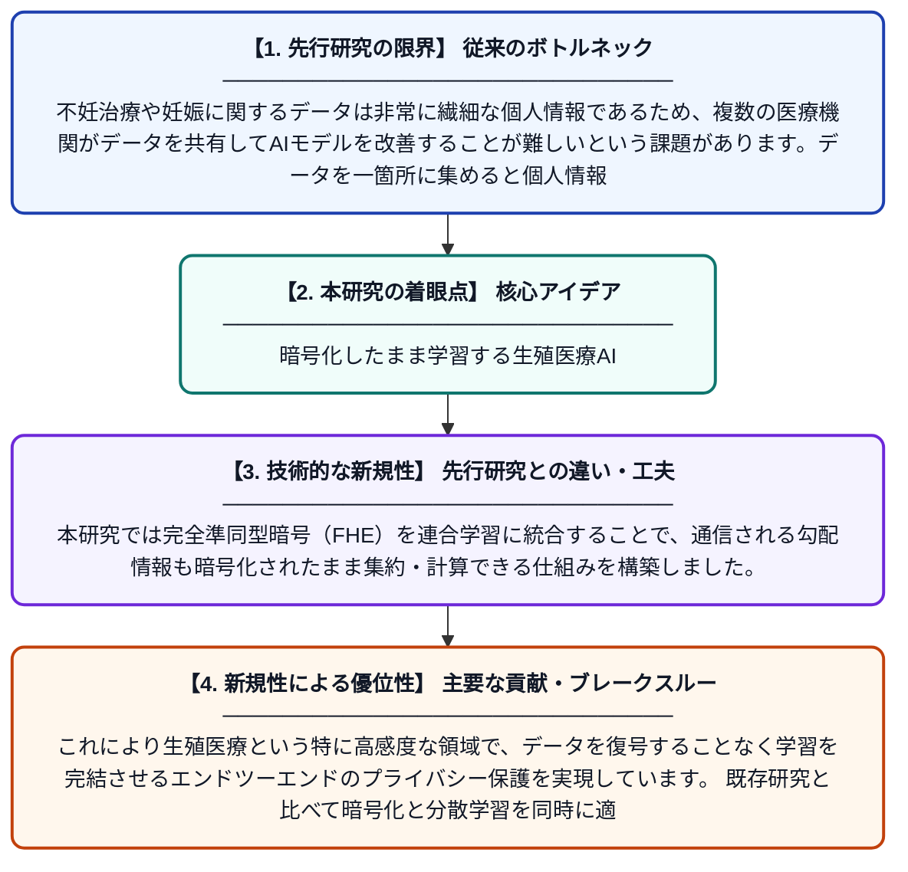

# 完全準同型暗号を用いたプライバシー保護型連合学習フレームワークによる生殖医療健康分析

**Original Title**: *A Privacy-Preserving Federated Learning Framework with Fully Homomorphic Encryption for Reproductive Health Analytics*

> **💡 一言要約**: 暗号化したまま学習する生殖医療AI

| 項目 | 内容 |
|---|---|
| **著者** | A Hassan, SU Mushtaq, H Edrees, A Alquatesh |
| **掲載誌** | Journal of Cyber Security and Risk Analytics 2026 |
| **アラートキーワード** | Federated Learning |
| **原文リンク** | [https://jcsra.thestap.com/archives/volume-2026-2/6a40fa33d0a08ff11a77f3f6](https://jcsra.thestap.com/archives/volume-2026-2/6a40fa33d0a08ff11a77f3f6) |
| **PDF版要約** | [README.pdf](./README.pdf) |

---

## 📊 新規性の図解（先行研究との違いと本研究のブレークスルー）

## 📝 要約

本論文は、不妊治療や妊娠に関するデータを複数の医療機関が共同で分析しながらも、個人情報を守るためのプラットフォームを提案しています。連合学習（FL）と完全準同型暗号（FHE）を組み合わせることで、生データを外部に送ることなく暗号化された状態のまま機械学習モデルを訓練します。これにより、プライバシーとデータ活用のトレードオフを解消し、生殖医療分野における安全なデータ共有基盤を実現しています。

## ❓ どんな問題に取り組んだか

不妊治療や妊娠に関するデータは非常に繊細な個人情報であるため、複数の医療機関がデータを共有してAIモデルを改善することが難しいという課題があります。データを一箇所に集めると個人情報漏洩のリスクが高まり、患者の信頼を損なう可能性があります。このプライバシーとデータ活用の両立をどのように実現するかが本研究の主要な問題です。

## ✨ 何が新しい？何がすごい？（新規性）

従来の連合学習はデータを分散管理できるものの、モデルの更新情報から個人情報が推定される「推論攻撃」のリスクが残っていました。本研究では完全準同型暗号（FHE）を連合学習に統合することで、通信される勾配情報も暗号化されたまま集約・計算できる仕組みを構築しました。これにより生殖医療という特に高感度な領域で、データを復号することなく学習を完結させるエンドツーエンドのプライバシー保護を実現しています。既存研究と比べて暗号化と分散学習を同時に適用した点が主要な貢献です。

## 🎓 大学1年生向けの解説

病院には患者さんの妊娠や不妊治療に関する大切なデータがありますが、これを他の病院と共有するのはプライバシーの問題で難しいです。この研究では『連合学習』という技術を使い、データを外に出さずに各病院のコンピュータだけで学習させ、その結果だけを共有する仕組みを作りました。さらに『完全準同型暗号』という魔法のような暗号技術を使って、データを暗号化したまま計算できるようにしました。例えるなら、金庫を開けずに金庫の中身を数えられるようなイメージです。これにより、個人情報を守りながら多くの病院のデータを活用した高精度なAI診断が可能になります。
