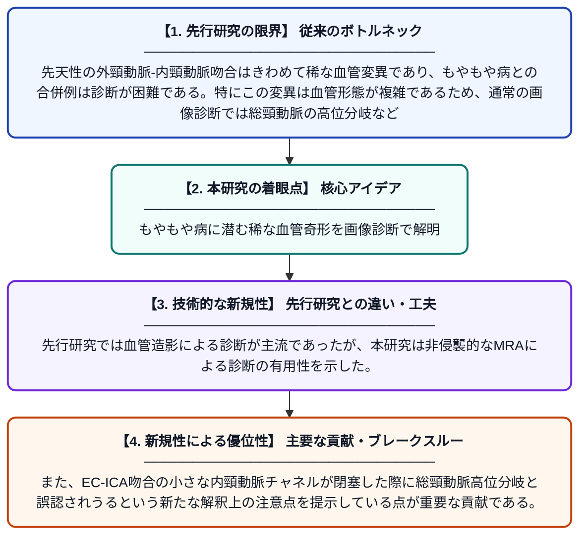

# MRアンギオグラフィーにより診断されたもやもや病に合併した先天性外頸動脈-内頸動脈吻合

**Original Title**: *Congenital external carotid-internal carotid artery anastomosis associated with moyamoya disease diagnosed by magnetic resonance angiography*

> **💡 一言要約**: もやもや病に潜む稀な血管奇形を画像診断で解明

| 項目 | 内容 |
|---|---|
| **著者** | H Hayashi, A Uchino, M Nishikata, Y Baba |
| **掲載誌** | Radiology Case Reports 2026 |
| **アラートキーワード** | ICA |
| **原文リンク** | [https://www.sciencedirect.com/science/article/pii/S193004332600600X](https://www.sciencedirect.com/science/article/pii/S193004332600600X) |
| **PDF版要約** | [README.pdf](./README.pdf) |

---

## 📊 新規性の図解（先行研究との違いと本研究のブレークスルー）

## 📝 要約

本論文は、もやもや病に合併した先天性外頸動脈-内頸動脈（EC-ICA）吻合の稀な症例をMRアンギオグラフィーで診断した症例報告である。この血管変異では、EC-ICA吻合の細い内頸動脈チャネルが閉塞した場合、総頸動脈の高位分岐として誤解釈される可能性がある。画像診断における注意点と鑑別診断の重要性を示している。

## ❓ どんな問題に取り組んだか

先天性の外頸動脈-内頸動脈吻合はきわめて稀な血管変異であり、もやもや病との合併例は診断が困難である。特にこの変異は血管形態が複雑であるため、通常の画像診断では総頸動脈の高位分岐など別の異常と誤診される危険性がある。

## ✨ 何が新しい？何がすごい？（新規性）

本症例は、もやもや病に合併した先天性EC-ICA吻合をMRアンギオグラフィーで詳細に描出した稀な報告である。先行研究では血管造影による診断が主流であったが、本研究は非侵襲的なMRAによる診断の有用性を示した。また、EC-ICA吻合の小さな内頸動脈チャネルが閉塞した際に総頸動脈高位分岐と誤認されうるという新たな解釈上の注意点を提示している点が重要な貢献である。

## 🎓 大学1年生向けの解説

脳には血液を送るための動脈が複数あり、通常は決まったルートで繋がっています。今回の患者さんは、本来つながるはずのない外頸動脈と内頸動脈が生まれつき直接つながっているという非常に珍しい状態で、さらに「もやもや病」という脳の血管が細くなる病気も併発していました。MRI（磁気共鳴画像）を使った特殊な血管撮影法によって、血管の手術をせずにこの複雑な構造を診断することができました。この研究は、珍しい血管のつながり方が誤診につながる可能性を指摘しており、医師が画像を読む際の重要な注意点を示しています。
