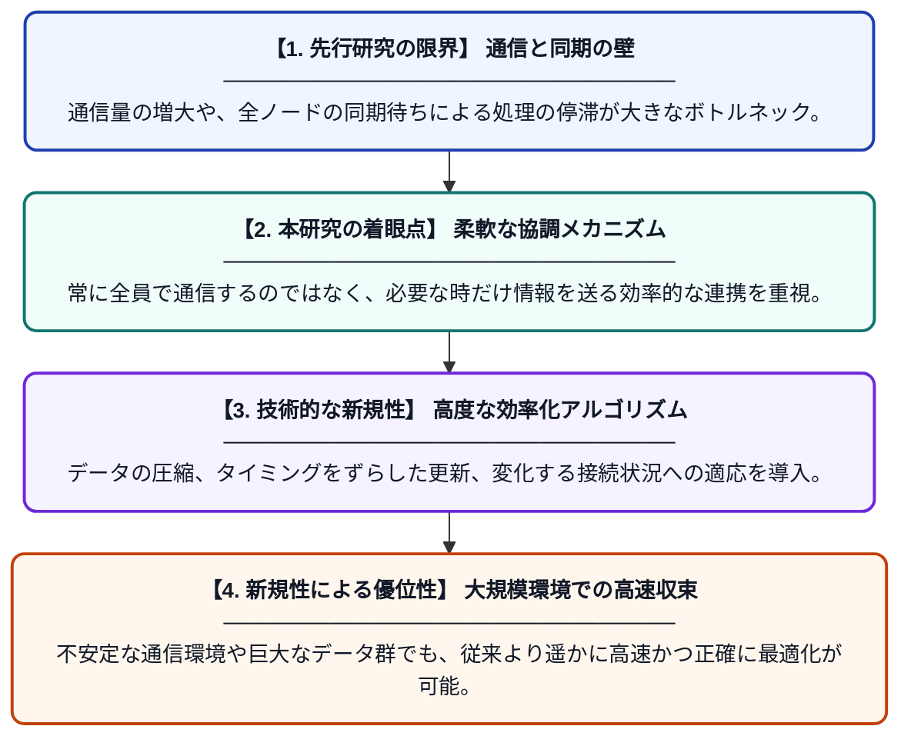

# 分散最適化の過去10年：アルゴリズムの進展と新たな方向性

**Original Title**: *Distributed Optimization Over the Past Decade: Algorithmic Advances and Emerging Directions*

> **💡 一言要約**: 10年の進化を凝縮した分散最適化の完全ガイド

| 項目 | 内容 |
|---|---|
| **著者** | W Xu, J Liu, S Yang, W Yu, L Rutkowski, L Sun, J Liang |
| **掲載誌** | IEEE Transactions on … 2026 |
| **アラートキーワード** | optimization |
| **原文リンク** | [https://ieeexplore.ieee.org/abstract/document/11796587/](https://ieeexplore.ieee.org/abstract/document/11796587/) |
| **PDF版要約** | [README.pdf](./README.pdf) |

---

## 📊 新規性の図解（先行研究との違いと本研究のブレークスルー）

## 📝 要約

この論文は、過去10年間における分散最適化の主要な進歩を包括的にレビューし、今後の展望をまとめたものです。標準的な分散最適化の枠組みから始まり、大規模化するデータや複雑なネットワーク環境に対応するための最新アルゴリズムを体系的に解説しています。

## ❓ どんな問題に取り組んだか

大規模なデータを1台の計算機で処理することが困難になり、複数のノードで協調する分散最適化が必須となっています。しかし、ノード間の通信遅延、データの偏り、ネットワークの不安定さが、計算の効率と正確性を妨げる大きな課題でした。

## ✨ 何が新しい？何がすごい？（新規性）

本研究は、過去10年の膨大な研究成果を整理し、通信圧縮、非同期更新、イベントトリガー制御といった最新技術がどのように課題を解決してきたかを理論的に解明しました。単なる手法の羅列ではなく、動的なネットワークや非凸最適化といった困難な条件下での収束性を体系化した点が大きな貢献です。さらに、プライバシー保護やリソース制約を考慮した次世代の設計指針を明確に提示しています。

## 🎓 大学1年生向けの解説

「大きすぎて1人では解けない宿題」を、クラス全員で分担して解く方法を研究するのが分散最適化です。これまでは全員の足並みを揃えるのに時間がかかったり、連絡を取り合うのが大変だったりしました。この論文は、過去10年で「どうすればサボる人や連絡が遅い人がいても、みんなで正解にたどり着けるか」という工夫がどう進化したかをまとめたものです。これからのAIや大規模な計算に欠かせない、チームワークの魔法のような技術を学べます。
