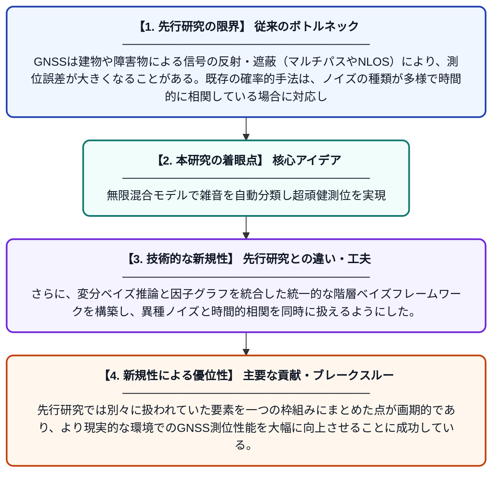

# ディリクレ過程混合モデルを用いた変分ベイズ因子グラフ最適化による頑健なGNSS測位

**Original Title**: *Robust GNSS Positioning via Variational Bayesian Factor Graph Optimization with Dirichlet Process Mixture Models*

> **💡 一言要約**: 無限混合モデルで雑音を自動分類し超頑健測位を実現

| 項目 | 内容 |
|---|---|
| **著者** | Z Yang, Y Wang, Y Shen |
| **掲載誌** | IEEE Transactions on Wireless Communications 2026 |
| **アラートキーワード** | Bayesian hierarchical ... |
| **原文リンク** | [https://ieeexplore.ieee.org/abstract/document/11627154/](https://ieeexplore.ieee.org/abstract/document/11627154/) |
| **PDF版要約** | [README.pdf](./README.pdf) |

---

## 📊 新規性の図解（先行研究との違いと本研究のブレークスルー）

## 📝 要約

本論文は、GNSS（全地球航法衛星システム）測位における異常ノイズや時間的相関の問題を解決するため、ディリクレ過程混合モデルと変分ベイズ推論を組み合わせた新しい因子グラフ最適化フレームワークを提案する。従来の確率的手法が抱えていた、ベイズ階層モデルの統一的枠組みの欠如や異種ノイズへの対応不足という課題を克服している。提案手法は、無限混合モデルにより雑音分布を自動的に推定しながら、頑健かつ高精度な位置推定を実現する。

## ❓ どんな問題に取り組んだか

GNSSは建物や障害物による信号の反射・遮蔽（マルチパスやNLOS）により、測位誤差が大きくなることがある。既存の確率的手法は、ノイズの種類が多様で時間的に相関している場合に対応しきれず、また混合モデルの成分数を事前に決める必要があるなど柔軟性に欠けていた。これらの課題が、都市部などの厳しい環境での高精度測位を困難にしていた。

## ✨ 何が新しい？何がすごい？（新規性）

本研究の最大の新規性は、ディリクレ過程（無限混合モデル）を用いることで、雑音分布の成分数を事前に指定せず自動的に推定できる点である。さらに、変分ベイズ推論と因子グラフを統合した統一的な階層ベイズフレームワークを構築し、異種ノイズと時間的相関を同時に扱えるようにした。先行研究では別々に扱われていた要素を一つの枠組みにまとめた点が画期的であり、より現実的な環境でのGNSS測位性能を大幅に向上させることに成功している。

## 🎓 大学1年生向けの解説

スマートフォンやカーナビに使われるGPS（より正確にはGNSS）は、ビルが多い場所では信号が反射して位置がずれてしまうことがあります。この論文では、そのような「変なノイズ（誤差）」を自動で見つけて取り除く賢い数学的な仕組みを開発しました。「ディリクレ過程」という手法を使うことで、ノイズのパターンが何種類あるかを自分で学習できるため、事前に人間が設定しなくてよいのがポイントです。さらに「因子グラフ」と「ベイズ統計」という道具を組み合わせることで、過去の情報も活かしながら効率よく位置を推定できます。結果として、難しい環境でも高精度な測位が可能になりました。
