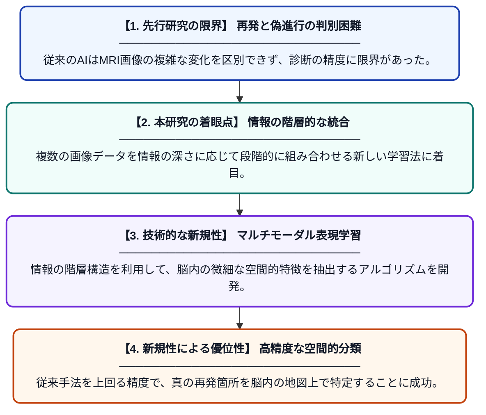

# グリオーマ再発の空間的分類のためのマルチモーダル階層的表現学習

**Original Title**: *IMG-86 Multimodal hierarchical representation learning for spatial classification of glioma recurrence*

> **💡 一言要約**: AIが脳腫瘍の再発と治療の影響を正確に判別

| 項目 | 内容 |
|---|---|
| **著者** | J Ellison, N Tran, H Kukreja, B Liu, T Luks, A Jakary… |
| **掲載誌** | Neuro-Oncology 2026 |
| **アラートキーワード** | representation learning |
| **原文リンク** | [https://academic.oup.com/neuro-oncology/article/28/Supplement_4/noag189.851/9043979](https://academic.oup.com/neuro-oncology/article/28/Supplement_4/noag189.851/9043979) |
| **PDF版要約** | [README.pdf](./README.pdf) |

---

## 📊 新規性の図解（先行研究との違いと本研究のブレークスルー）

## 📝 要約

脳腫瘍（グリオーマ）の治療後、MRIで再発と治療による損傷（偽進行）を見分けることは困難です。本研究では、複数の画像データを階層的に統合して学習するAIモデルを開発し、脳内の再発箇所を正確に特定する手法を提案しました。

## ❓ どんな問題に取り組んだか

グリオーマの治療後、MRIに現れる「影」が再発なのか、それとも放射線治療などによる一時的な組織損傷（偽進行）なのかを判断するのは非常に困難です。既存のAIモデルでは、複数の画像情報を統合して脳内の複雑な空間変化を正確に捉える能力が不足しており、誤診のリスクが課題でした。

## ✨ 何が新しい？何がすごい？（新規性）

本研究の革新性は、複数の画像ソースを単純に統合するのではなく、階層的に情報の深さを学習する「階層的表現学習」を採用した点にあります。これにより、微細な解剖学的特徴と広域的な病変のパターンを同時に分析し、脳内のどの場所で再発が起きているかを空間的に高精度で特定可能にしました。従来の単一的な分析手法と比較して、再発と治療損傷の識別性能が大幅に向上しています。

## 🎓 大学1年生向けの解説

脳腫瘍の治療をした後にMRIを撮ると、また腫瘍が大きくなったように見えることがありますが、実はそれが「本当の再発」なのか「治療の副作用による腫れ」なのかを判断するのはプロの医者でも至難の業です。この研究では、最新のAIを使って、いろいろな種類の画像を一度に、かつ深く分析する新しい仕組みを作りました。このAIを使うと、脳のどの部分が危ない状態なのかを地図のように正確に見分けることができます。これによって、患者さんにとって本当に必要な治療を早く見つけられるようになります。
